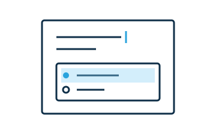

# Nest content

A widget can show text, HTML elements, and other widgets in its interface. Its editing configuration specifies which children authors can add and edit. The widget can respond to changes in its child elements.



<!-- live-example: Nested content -->

```js vanilla
class CalloutWidget extends HTMLElement {
  constructor() {
    super()
    this.attachShadow({mode: "open"}).innerHTML = `
      <aside><slot></slot></aside>
      <output aria-live="polite"></output>`
    this.shadowRoot.querySelector("slot").addEventListener("slotchange", event => {
      const count = event.target.assignedElements().length
      this.shadowRoot.querySelector("output").textContent = `${count} authored items`
    })
  }
}

customElements.define("ww-callout", CalloutWidget)
```

```html
<ww-callout>
  <p>Bring a reusable water bottle.</p>
  <p>Meet beside the north gate.</p>
</ww-callout>
```

<!-- /live-example -->

Keep authored content in the widget's light DOM. Use a [slot](https://developer.mozilla.org/en-US/docs/Web/HTML/Reference/Elements/slot) to show that content. This callout widget lets authors edit a note in the document.

```html
<ww-callout><p>Bring a reusable water bottle.</p></ww-callout>
```

```html
<!-- In the widget's shadow DOM -->
<slot></slot>
```

Declare the child elements that authors can insert and edit.

```json
{
  "editingConfig": {
    "./widgets/ww-callout": {"content": "p+", "marks": "b i"}
  }
}
```

The authoring tool treats the widget as a single element if the configuration has no `content` entry. For nested widgets, specify their tag names or groups in the [content expression](../reference/content-expressions.md). Set `uninsertable: true` if authors can insert the child widget only through a parent or snippet.

## Exclude descendants

By default, the editor prevents authors from nesting a widget anywhere inside another instance of the same tag. A quiz prompt that accepts `flow*` inherits this restriction from its enclosing quiz, including inside wrappers.

Set `excludedDescendants` on the enclosing widget to specify the tags it forbids throughout its editable content. This quiz excludes both other quizzes and tables from its prompt.

```json
{
  "editingConfig": {
    "./widgets/ww-quiz": {
      "content": "ww-quiz-prompt",
      "excludedDescendants": ["ww-quiz", "table"]
    },
    "./widgets/ww-quiz-prompt": {"content": "flow*"}
  }
}
```

An explicit list replaces the default, so include the widget's own tag to keep blocking self-nesting. Use `[]` for a widget designed to nest inside itself wherever its content expression allows. [Editing configuration reference](../reference/editing-configuration.md#restrict-placement-and-movement)

## Respond to content changes

Use [`slotchange`](https://developer.mozilla.org/en-US/docs/Web/API/HTMLSlotElement/slotchange_event) to detect changes to slot assignments. Use a [`MutationObserver`](https://developer.mozilla.org/en-US/docs/Web/API/MutationObserver) to detect changes to the content of those children. Disconnect the observers when the widget disconnects. Examine the current children before you change them. Keep unfamiliar children, comments, and grouping metadata.
