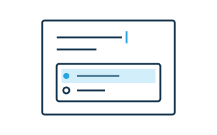

# Nest widgets and editable content

Widgets can contain authored text and other widgets.



Keep authored content in the widget's light DOM and display it with a slot:

```html
<ww-quiz><p>The Moon is a star.</p></ww-quiz>
```

```html
<!-- In the widget's shadow DOM -->
<slot></slot>
```

Declare which children the editor can insert and edit:

```json
{
  "editingConfig": {
    "./widgets/ww-quiz": {"content": "p+", "marks": "b i"}
  }
}
```

Without `content`, the widget is atomic to the document editor. For nested widgets, use their tag names or groups in the [content expression](../reference/content-expressions.md). Use `uninsertable: true` for a child widget that should only appear through a parent or snippet.

Use `slotchange` to react to assigned children and a `MutationObserver` when their contents matter. Disconnect observers when the widget disconnects. Inspect the current children before changing them, and preserve unfamiliar children, comments, and grouping metadata.
