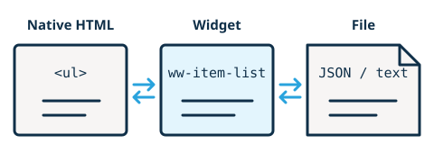

# Convert & import/export

A widget can convert HTML content to an interactive element. It can also convert its content to native HTML. The widget can import and export files in the formats it declares.



<!-- live-example: Convert a list -->

```js vanilla
class PackingChecklist extends HTMLElement {
  static convertFrom = {ul: "loadList", ".json": "importJson"}
  static convertTo = {ul: "toList", "text/plain": "exportText"}

  constructor() {
    super()
    this.attachShadow({mode: "open"}).innerHTML = `
      <slot></slot>
      <label>Import a JSON list <input type="file" accept=".json,application/json"></label>
      <button type="button">Preview exported list</button>
      <button type="button">Preview text file</button>
      <pre role="status"></pre>`
    const root = this.shadowRoot
    const result = root.querySelector("pre")
    const [listButton, textButton] = root.querySelectorAll("button")
    listButton.addEventListener("click", () => { result.textContent = this.toList()?.outerHTML ?? "" })
    textButton.addEventListener("click", async () => { result.textContent = await this.exportText().text() })
    root.querySelector("input").addEventListener("change", async event => {
      const file = event.target.files[0]
      if(!file) return
      try {
        const apply = await this.importJson(file)
        apply()
        result.textContent = "List imported."
      }
      catch(error) { result.textContent = error.message }
    })
  }

  loadList(fragment) {
    this.replaceChildren(fragment)
  }

  toList() {
    return this.querySelector(":scope > ul")?.cloneNode(true) ?? null
  }

  async importJson(file) {
    const values = JSON.parse(await file.text())
    if(!Array.isArray(values) || !values.every(value => typeof value === "string")) {
      throw new Error("Expected a JSON array of strings.")
    }
    const list = document.createElement("ul")
    for(const value of values) {
      const item = document.createElement("li")
      item.textContent = value
      list.append(item)
    }
    return () => this.loadList(list)
  }

  exportText() {
    const items = this.querySelectorAll(":scope > ul > li")
    return new File([Array.from(items, item => item.textContent).join("\n")],
      "packing-list.txt", {type: "text/plain"})
  }
}

customElements.define("ww-packing-checklist", PackingChecklist)
```

```html
<ww-packing-checklist>
  <ul><li>Water bottle</li><li>Notebook</li></ul>
</ww-packing-checklist>
```

<!-- /live-example -->

Use `convertFrom` to specify what the widget can read. Use `convertTo` to specify what it can write. A key that is a lowercase HTML tag name, such as `ul`, always means a conversion between HTML elements. A key that is a file extension, such as `.json`, or a [media type](https://developer.mozilla.org/en-US/docs/Web/HTTP/Guides/MIME_types), such as `image/png`, always means a file conversion.

The authoring tool shows available conversions for the selected element. Authors can open the Widget drawer or select the element icon to find them. A dotted underline in the Packages drawer identifies an installed widget that can accept the selected element.

## Convert between a native list and a packing checklist

The packing checklist keeps a native list in its light DOM. The authoring tool passes a detached copy of the selected list to `loadList`. It replaces the selected list with the widget. The `toList` method returns a detached copy of the widget's list. The authoring tool can undo the replacement in one step.

```js
class PackingChecklist extends HTMLElement {
  static convertFrom = {ul: "loadList"}
  static convertTo = {ul: "toList"}

  loadList(fragment) {
    this.replaceChildren(fragment)
  }

  toList() {
    return this.querySelector(":scope > ul")?.cloneNode(true) ?? null
  }
}

customElements.define("ww-packing-checklist", PackingChecklist)
```

Declare `"content": "ul"` in the [editing configuration](../reference/editing-configuration.md) to let authors edit the list in place. To export adjacent elements, return a [`DocumentFragment`](https://developer.mozilla.org/en-US/docs/Web/API/DocumentFragment) with elements of the declared tag. A timeline, for example, can return `details` elements.

## Add file formats to the same maps

Replace the two maps with the declarations that follow. Add the methods to the class.

```js
static convertFrom = {ul: "loadList", ".json": "importJson"}
static convertTo = {ul: "toList", "text/plain": "exportText"}

async importJson(file) {
  const values = JSON.parse(await file.text())
  if(!Array.isArray(values) || !values.every(value => typeof value === "string")) {
    throw new Error("Expected a JSON array of strings.")
  }

  const list = this.ownerDocument.createElement("ul")
  for(const value of values) {
    const item = this.ownerDocument.createElement("li")
    item.textContent = value
    list.append(item)
  }
  return () => this.replaceChildren(list)
}

exportText() {
  const items = this.querySelectorAll(":scope > ul > li")
  const text = Array.from(items, item => item.textContent).join("\n")
  return new File([text], "packing-list.txt", {type: "text/plain"})
}
```

A file such as `packing-list.json` can contain `["Water bottle", "Notebook", "Rain jacket"]`. The import method reads the file. It checks the data before it returns a function. The authoring tool runs that function synchronously if the authored content has not changed. The authoring tool can undo the import in one step.

Use a file extension as the key if the filename identifies the format. For example, `".json": "importJson"` permits import when the file has no media type. The authoring tool uses the key to filter the file chooser and identify the file. Check the file contents in the import handler.

For an export, use the declared extension in the filename or set the declared media type. The authoring tool downloads the file.

Declare `"importFormats": [".json"]` and `"exportFormats": ["text/plain"]` in the widget's editing configuration. The configuration lists file formats only. Do not list tag names such as `ul` there. The authoring tool finds tag conversions in the runtime maps. The runtime methods do the conversions. See the [editing configuration reference](../reference/editing-configuration.md#advertise-file-formats).

The [runtime reference](../reference/runtime.md#conversions) lists return values and gives the order of precedence for instance and class declarations.

## Supported conversion types

A key of `convertFrom` or `convertTo` has one of three forms. The form of the key decides what the handler receives or returns. A key never has two meanings.

| Key | Example | Kind | Import handler | Export handler |
|---|---|---|---|---|
| Lowercase tag name of an HTML element | `ul`, `details`, `figure` | HTML conversion | Receives a detached fragment with a copy of the element. | Returns a detached element or fragment of that tag. |
| File extension | `.json`, `.puml`, `.tar.gz` | File conversion | Receives a `File` whose name ends with the extension. | Returns a `File` whose name ends with the extension. |
| Concrete media type | `text/csv`, `image/png` | File conversion | Receives a `File` with that `type`. | Returns a `File` with that `type`. |

Follow these rules for keys:

- A tag key names a native element of the document, in lowercase and without angle brackets. The authoring tool offers the conversion only for elements that it knows as content of the document body. Custom element names, SVG and MathML elements, `html`, and `body` are not conversion keys. Uppercase names are ignored.
- An extension key starts with a dot. It has letters, digits, `_`, and `-`, and can have several parts. The authoring tool compares it with the end of the file name without regard to case. Use it for formats without a registered media type, such as `.jff`, `.gift`, `.puml`, or `.mmd`, and for formats that browsers report without a type.
- A media type key has the form `type/subtype`. Wildcards such as `image/*` are not allowed. The authoring tool compares the key with the type of the file without parameters and without regard to case. A file with an empty type cannot match.
- A format can have an extension key and a media type key with the same handler, as in `".json": "importJson", "application/json": "importJson"`. The authoring tool offers the file chooser for both keys.
- `importFormats` and `exportFormats` in the [editing configuration](../reference/editing-configuration.md#advertise-file-formats) list the keys of file conversions. They never contain tag names or wildcards. The Develop drawer reports a tag name in one of these lists as an invalid editing option.

For an HTML conversion the authoring tool replaces the element and checks that the result fits at that place. A file conversion keeps the widget in the document. See the [runtime reference](../reference/runtime.md#conversions) for all return values.

## Validation of imported files

The authoring tool checks the extension or media type of the chosen file against the key. It cannot know what the file contains. Your import handler decides whether the content is usable. The tool treats every file as untrusted input.

Follow these steps in the handler:

1. Check `file.size` before you read the file. Reject a file above your limit without reading it.
2. Read and parse the file. Use `file.text()` for text and `file.arrayBuffer()` for binary data.
3. Check the structure and the values. Check counts, such as the number of rows, nodes, or bases, against a limit as well.
4. Build the result off the document, for example as elements or plain objects.
5. Return a function that applies the result. Change the document in that function only.

The tool runs the returned function synchronously, as one undo step, when the widget has not changed since the import began. An import that fails in steps 1 to 4 leaves the document untouched.

### Report a bad file

Throw an `Error`, or return a rejected promise, with a message that tells the author what is wrong with the file. The authoring tool shows the message to the author and changes nothing. The standalone widget drawer shows it too. Write the message for the author and localize it with the widget's [localization](../reference/lit.md#localization-localizer-widgetmsg), as in `throw new Error(msg("Expected a JSON array of strings."))`, where `msg` is the widget's translation function. Name the limit or the expected form. Do not include stack traces or file contents.

An `Error` without a message, a thrown string without text, and other failures that carry no message show a generic text such as "The file could not be imported into the selected widget." Return `null` or `false` to decline a file quietly. The authoring tool then shows the same generic text. Use that only for a file that the widget cannot handle and for which it has nothing to say.

A handler has ten seconds to prepare its result. After that, the authoring tool reports a timeout and ignores a late result.

```js
const maxBytes = 1024 * 1024
const maxItems = 500

async importJson(file) {
  if(file.size > maxBytes) throw new Error(msg("The file is larger than 1 MiB."))
  let values
  try { values = JSON.parse(await file.text()) }
  catch { throw new Error(msg("The file is not valid JSON.")) }
  if(!Array.isArray(values) || !values.every(value => typeof value === "string")) {
    throw new Error(msg("Expected a JSON array of strings."))
  }
  if(values.length > maxItems) throw new Error(msg("The list has more than 500 items."))
  return () => this.replaceChildren(this.buildList(values))
}
```

### Choose size limits

Imported content becomes part of the saved document. Collaborators receive it, and undo keeps it. Base the limit on what the widget can display and what a document can hold. Do not base it on what the browser can read. These values are a starting point:

| Content | Limit for `file.size` | Also limit |
|---|---|---|
| Text and data formats (JSON, CSV, diagram sources) | 1 MiB | The number of rows, nodes, or items that the widget draws. |
| Images, audio, or other binary data that the widget embeds | 8 MiB | The pixel size of images. |

Choose a lower limit when the widget slows down earlier. Say the limit in the message, with its unit. Do not build HTML from file contents with `innerHTML`. Create elements and set `textContent`, or use a sanitizer for formats such as SVG.
