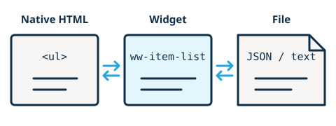

# Convert, import, and export widget content

Use `convertFrom` for the formats your widget can read and `convertTo` for the formats it can produce. A native tag like `ul` exchanges authored DOM. A file extension like `.json` or media type like `text/plain` exchanges a file.



Authors can use the Widget drawer in the Edit ribbon or click the element icon in the toolbox to find available commands. When a native element can become an installed widget, the widget's button in the Packages drawer has a dotted underline.

## Convert between a list and a widget

The widget below stores a native list in its light DOM. When converting a selected list, the editor gives `loadList` a detached copy and inserts the populated widget in the list's place. When converting back, `toList` returns a detached copy of the widget's list. The editor replaces the source in one undo step.

```js
class ItemList extends HTMLElement {
  static convertFrom = {ul: "loadList"}
  static convertTo = {ul: "toList"}

  loadList(fragment) {
    this.replaceChildren(fragment)
  }

  toList() {
    return this.querySelector(":scope > ul")?.cloneNode(true) ?? null
  }
}

customElements.define("ww-item-list", ItemList)
```

Declare `"content": "ul"` in the widget's [editing configuration](../reference/editing-configuration.md) if authors should edit the list in place. To export several siblings, return a `DocumentFragment` with one or more elements of the declared tag. For example, a timeline can return a fragment of `details` elements.

## Add file formats to the same maps

Replace the two maps in the example with these declarations, then add the methods below inside the class.

```js
static convertFrom = {ul: "loadList", ".json": "importJson"}
static convertTo = {ul: "toList", "text/plain": "exportText"}

async importJson(file) {
  const values = JSON.parse(await file.text())
  if(!Array.isArray(values) || !values.every(value => typeof value === "string")) {
    throw new Error("Expected a JSON array of strings.")
  }

  const list = this.ownerDocument.createElement("ul")
  for(const value of values) {
    const item = this.ownerDocument.createElement("li")
    item.textContent = value
    list.append(item)
  }
  return () => this.replaceChildren(list)
}

exportText() {
  const items = this.querySelectorAll(":scope > ul > li")
  const text = Array.from(items, item => item.textContent).join("\n")
  return new File([text], "items.txt", {type: "text/plain"})
}
```

The import accepts a file such as `items.json` containing `["Mercury", "Venus", "Earth"]`. It reads and validates the file before returning a function. The editor calls that function synchronously in one undo step if the widget still has the authored content it had when the import began.

Use an extension key when the filename identifies the format. For example, `".h5p": "importH5p"` lets a quiz offer H5P import even if the file has no reported media type. The editor uses the key to filter the chooser and match the selected file. Your handler validates the actual contents. For exports, name the returned file with the declared extension or set its media type to the declared type. The editor handles the download.

To make these file formats discoverable from package metadata, declare `"importFormats": [".json"]` and `"exportFormats": ["text/plain"]` in the widget's editing config. The lists advertise the formats. The runtime methods implement them. [Editing configuration reference](../reference/editing-configuration.md#advertise-file-formats)

See the [runtime reference](../reference/runtime.md#conversions) for return values and how instance declarations override class declarations.
