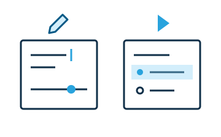

# Support editing and viewing

Authors configure widgets; users interact with the finished document.



<!-- library:vanilla -->
Use `this.isContentEditable` to distinguish the two views.

```css
/* In the widget's shadow styles */
:host([contenteditable]) .user-controls { display: none; }
:host(:not([contenteditable])) .author-hint { display: none; }
```

These selectors suit the editor's runtime empty `contenteditable` attribute. If your widget permits authored `contenteditable="false"`, use `isContentEditable` in script to handle that value too.

Observe `contenteditable` if changing mode requires a script update. Expose simple author settings through [options and actions](../reference/options-actions.md), which WebWriter displays in the Widget drawer.

<!-- /library -->
<!-- library:lit -->
Use `this.editable` in your `LitElementWw` template and interaction handlers. The base requests an update when the widget or an ancestor changes editing mode:

```js
choose(value) {
  if(this.editable) return
  this.choice = value
}

render() {
  return html`
    <slot></slot>
    <button ?hidden=${this.editable} @click=${() => this.choose("false")}>False</button>
    <p ?hidden=${!this.editable}>Edit the question, then use Preview.</p>`
}
```

Import `html` from `lit`. Expose simple author settings through [options and actions](../reference/options-actions.md), which WebWriter displays in the Widget drawer.
<!-- /library -->

Keep widget controls in shadow DOM. Leave editor-owned `contenteditable` and `◆` marker classes to the editor. Test both modes using **Preview**, and save and reopen the document to check the resulting state.
