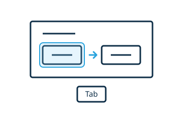

# Handle focus and keyboard input

Use native buttons, inputs, and labels in the shadow DOM. They already support keyboard interaction.



If focusing the widget should focus a control, implement `focus()`:

```js
focus(options) {
  this.shadowRoot.querySelector("button")?.focus(options)
}
```

Keep focus visible with `:focus-visible`. Use an `<output aria-live="polite">` for feedback that should be announced after an interaction.

Events inside the widget's shadow DOM are ignored by editor features by default. If the editor should handle a particular event type, opt in with `propagateEvents`, for example `["keydown"]`. Check shortcuts while using inputs so typing does not trigger unwanted editor commands.

Test Tab, Shift+Tab, Enter, and Space in editing and preview. Update existing controls rather than rebuilding the shadow DOM after every interaction, so focus is retained.
