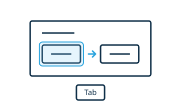

# Handle selection & input

A widget can move keyboard focus to its controls. It can specify which input events the authoring tool must receive. It can also move the caret to the authored content.



Use native buttons, inputs, and labels in the shadow DOM to get standard keyboard behavior.

Implement [`focus()`](https://developer.mozilla.org/en-US/docs/Web/API/HTMLElement/focus) to move focus from the widget to a control. In this example, a soundboard moves focus to its first sound button.

```js
focus(options) {
  this.shadowRoot.querySelector("button[data-sound]")?.focus(options)
}
```

Use [`:focus-visible`](https://developer.mozilla.org/en-US/docs/Web/CSS/Reference/Selectors/:focus-visible) to show which control has focus. Use [`<output aria-live="polite">`](https://developer.mozilla.org/en-US/docs/Web/Accessibility/ARIA/Reference/Attributes/aria-live) for feedback that an assistive technology must announce.

The authoring tool ignores input events from the widget's shadow DOM by default. List the required event types in `propagateEvents`, for example `["keydown"]`. Test the keyboard shortcuts in widget inputs. Make sure that typing causes only the intended actions.

## Move the document selection

When the widget host has direct focus, the authoring tool lets the widget handle input. When that host loses focus, the authoring tool selects the widget element. The widget can then use the native [Selection API](https://developer.mozilla.org/en-US/docs/Web/API/Selection) to change the document selection. This example moves the caret to an authored text node.

```js
this.blur()
const selection = this.ownerDocument.getSelection()
selection?.setPosition(textNode, 0)
```

Get `textNode` from the current document. Edits can replace or remove a node. Move focus away from the host before you set the selection. For this operation, the host must accept focus directly.

The authoring tool can follow selections in authored children while the widget has focus. To move the document selection outside the widget, first move focus away from the host.

Test Tab, Shift+Tab, Enter, and Space in edit mode and in preview. Update the existing controls to keep their focus.

## Keyboard focus order

## Pointer and touch input
