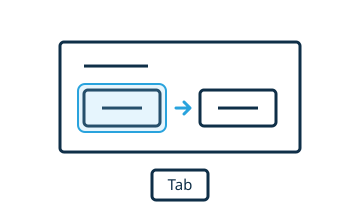

# Handle selection & input

A widget can move keyboard focus to its controls. It can specify which input events the authoring tool must receive. It can also move the caret to the authored content.



Select **Focus first sound**, then press Enter to activate the focused button. Use Tab and Shift+Tab to move between the controls.

<!-- live-example: Keyboard focus -->

```js vanilla
class Soundboard extends HTMLElement {
  constructor() {
    super()
    this.attachShadow({mode: "open"}).innerHTML = `
      <button data-sound type="button">Rain</button>
      <button data-sound type="button">Wind</button>
      <button id="focus" type="button">Focus first sound</button>
      <output aria-live="polite"></output>`
    this.shadowRoot.querySelector("#focus").addEventListener("click", () => this.focus())
    this.shadowRoot.addEventListener("click", event => {
      if(event.target.id === "focus") return
      if(!event.target.matches("[data-sound]")) return
      this.shadowRoot.querySelector("output").textContent = `Selected ${event.target.textContent}`
    })
  }

  focus(options) {
    this.shadowRoot.querySelector("[data-sound]")?.focus(options)
  }
}

customElements.define("ww-soundboard", Soundboard)
```

```html
<ww-soundboard></ww-soundboard>
```

<!-- /live-example -->

Use native buttons, inputs, and labels in the shadow DOM to get standard keyboard behavior.

Implement [`focus()`](https://developer.mozilla.org/en-US/docs/Web/API/HTMLElement/focus) to move focus from the widget to a control. In this example, a soundboard moves focus to its first sound button.

```js
focus(options) {
  this.shadowRoot.querySelector("button[data-sound]")?.focus(options)
}
```

Use [`:focus-visible`](https://developer.mozilla.org/en-US/docs/Web/CSS/Reference/Selectors/:focus-visible) to show which control has focus. Use [`<output aria-live="polite">`](https://developer.mozilla.org/en-US/docs/Web/Accessibility/ARIA/Reference/Attributes/aria-live) for feedback that an assistive technology must announce.

When returning focus to a capture-selected widget, including after inserting a snippet, the authoring tool calls the widget's custom `focus()` entry point. If a control inside that widget already has focus, it keeps that focus and its input selection. A widget can use `focus()` to choose its initial control without taking focus whenever an existing document loads. Wait for rendering if necessary, and check that the widget is still connected and focus has not moved elsewhere before focusing a control.

The authoring tool ignores input events from the widget's shadow DOM by default. List the required event types in `propagateEvents`, for example `["keydown"]`. Test the keyboard shortcuts in widget inputs. Make sure that typing causes only the intended actions.

## Capture selection and completed clicks

Capture selection lets a widget's own controls receive input. Ordinary element selection addresses the widget as document content, for example through the breadcrumb or transformation frame.

A pointer interaction acquires capture only after a completed click. Pointer-down alone does not capture the widget, and a drag or cancelled press does not become capture on release. Keyboard and programmatic focus can still acquire capture without a pointer click. Native input focus and text selection inside a shadow control remain intact when capture is established.

For a widget with declared editable `content`, clicking or dragging in authored light-DOM children edits that content. Keep private controls in the shadow DOM and expose authored children through slots so the editor can distinguish the two.

## Move the document selection

When the widget host has direct focus, the authoring tool lets the widget handle input. When that host loses focus, the authoring tool selects the widget element. The widget can then use the native [Selection API](https://developer.mozilla.org/en-US/docs/Web/API/Selection) to change the document selection. This example moves the caret to an authored text node.

```js
this.blur()
const selection = this.ownerDocument.getSelection()
selection?.setPosition(textNode, 0)
```

Get `textNode` from the current document. Edits can replace or remove a node. Move focus away from the host before you set the selection. For this operation, the host must accept focus directly.

The authoring tool can follow selections in authored children while the widget has focus. To move the document selection outside the widget, first move focus away from the host.

Test Tab, Shift+Tab, Enter, and Space in edit mode and in preview. Update the existing controls to keep their focus.

## Ranges through authored content

Declaring `content` opens the widget’s authored children to text selection across titles, paragraphs and slots. By default, `isolating: true` confines ranges started inside the widget to its content and prevents an outside range from ending partway inside it. Nested isolated widgets form their own boundaries. Select all inside an isolated widget selects that widget’s content.

Set `isolating: false` in the [editing configuration](../reference/editing-configuration.md) to allow partial ranges across the widget boundary. This does not override isolation declared by a nested widget. A drag that starts at a gap retains that gap as its anchor and can end partway through text. Dragging along either side of the widget projects the endpoint onto authored content at the pointer's height. During document drag selection, the page scrolls near the viewport edges rather than revealing the start of the growing range.

A fully enclosed widget receives the editor's blue range overlay, including widgets that expose editable content. Partial coverage keeps the authored text range. This also works for a `display: contents` host: selection geometry follows its rendered shadow and slotted boxes. Range highlighting does not acquire capture. Deleting a partial range removes the indicated content without promoting it to deletion of the enclosing widget.

The transformation frame offers figure conversion for a selected top-level element. Selecting a nested child does not offer conversion of that child or implicitly convert its containing widget. Existing top-level figures and tables retain their caption controls.

## Native editor drag handles

A widget can make a shadow control a native editor drag handle with `draggable="true"` and `propagateEvents: ["dragstart", "dragend"]` in its [editing configuration](../reference/editing-configuration.md). A forwarded handle can start an editor drag before capture has been established; the author does not need to click or select the widget first. The editor also supports dragging an already capture-selected or element-selected widget. Ordinary completed clicks on the control keep their native behavior. Keep `draggable` off authored text and the whole widget so authors can still select text normally.

The editor resolves drops within a contentful widget to gaps between its authored children, validates the resulting content against the schema, and draws its gap cursor in the shadow appendix. It rechecks the live source and destination on drop and moves the existing node, using `moveBefore()` where available and `insertBefore()` otherwise. The widget does not need its own drop handler, temporary light-DOM wrappers, or persisted ordering attributes. The transformation frame's Move affordance uses the same pipeline.

The receiving element's content expression and the child's groups constrain drop destinations just as they constrain ordinary insertion. `movable: false` disables editor movement even when a widget supplies a draggable control. Timeline events are excluded from `flow` and accepted explicitly by the timeline's content expression. They change their dates to reorder; their left-edge selection button is not a drag handle.

## Style editor selection

A widget can opt in to native CSS selection states by exposing its own `CustomStateSet` through a read-only `selectionStates` property. Attach internals once, or reuse the internals already owned by a form or accessibility helper:

```js
class TimelineEvent extends HTMLElement {
  #internals = this.attachInternals()
  get selectionStates() { return this.#internals.states }
}
```

The authoring tool maintains `ww-element-selected` while the widget is element-selected, including capture selection. It additionally sets `ww-element-capture-selected` while the widget captures input. It removes these states when selection changes or the editor is destroyed, including on disconnected widgets. Other custom states remain widget-owned. Keep the same set for the lifetime of the element, expose it before connection, and do not write these two editor-owned states yourself.

Use native selectors inside the widget's shadow stylesheet:

```css
:host(:state(ww-element-selected)) .indicator { opacity: 1; }
:host(:state(ww-element-capture-selected)) .controls { opacity: 1; }
/* Element selection without capture: */
:host(:state(ww-element-selected):not(:state(ww-element-capture-selected))) .indicator {
  outline-style: dotted;
}
```

These states describe selection of the widget itself, not text selected inside its authored children. They are transient and do not appear in saved HTML. The editor never calls `attachInternals()` on behalf of a widget or changes widgets that do not opt in.

Expose `selectionStates` on the element instance; it is not an editing-configuration field. Both states are present during capture, so use the combined selector above to distinguish ordinary element selection. A range spanning several widgets can highlight them without making each widget individually element-selected.

## Keyboard focus order

Tab visits focusable elements in the order of the document tree, and the shadow DOM of a widget is part of that tree at the place of its host. Write the template in reading order: the controls come before or after the content in the order a person expects them. Do not reorder with CSS (`order`, `grid-area`, `position`) in a way that makes the focus jump around the screen, and never use a positive [`tabindex`](https://developer.mozilla.org/en-US/docs/Web/HTML/Reference/Global_attributes/tabindex).

- Native controls are in the order already. Add `tabindex="0"` only to an element that has its own keys, such as a canvas stage or a list. Use `tabindex="-1"` for an element that script focuses.
- Authored children that a `<slot>` shows come in the focus order at the position of the slot, not at the position of the host.
- Make a group of related controls, such as a toolbar, a list of choices, or a grid, one Tab stop. The arrow keys move inside it (a roving `tabindex`), and Tab leaves it. Give the focused item `tabindex="0"` and the others `tabindex="-1"`.
- Never trap the focus. Tab and Shift+Tab must always leave the widget, also from a stage that takes the arrow keys.
- Take hidden controls out of the order with the [`hidden`](https://developer.mozilla.org/en-US/docs/Web/HTML/Reference/Global_attributes/hidden) attribute or [`inert`](https://developer.mozilla.org/en-US/docs/Web/HTML/Reference/Global_attributes/inert). An element with `display: none` is not focusable, but one that is only transparent or moved off screen still is.
- When the widget renders again, keep the focus on the same control. Replace the content of a list by updating its items, not by creating them again, or focus the equivalent item afterwards.

```js
// Roving tabindex: one Tab stop for the whole group.
#select(items, index) {
  items.forEach((item, position) => (item.tabIndex = position === index ? 0 : -1))
  items[index].focus()
}

#keydown(event) {
  const items = [...this.shadowRoot.querySelectorAll("[role=option]")]
  const current = items.indexOf(event.target)
  if(current < 0) return
  const next = {ArrowDown: current + 1, ArrowUp: current - 1, Home: 0, End: items.length - 1}[event.key]
  if(next === undefined || !items[next]) return
  event.preventDefault()
  this.#select(items, next)
}
```

Check the order in edit mode and in preview.

## Pointer and touch input

Use [pointer events](https://developer.mozilla.org/en-US/docs/Web/API/Pointer_events) (`pointerdown`, `pointermove`, `pointerup`, `pointercancel`) for one code path that serves a mouse, a pen, and a finger. Call [`setPointerCapture()`](https://developer.mozilla.org/en-US/docs/Web/API/Element/setPointerCapture) on `pointerdown` so that the moves arrive when the pointer leaves the element, and end the gesture on `pointercancel`, which a browser sends when it takes the touch for scrolling.

Every action that needs a drag or a gesture also needs a way without one: a click, a key, or a button. Do not make anything depend on hover. A tooltip is no place for the only explanation of a control.

### Target sizes

| Target | Size |
|---|---|
| Every control that a pointer presses: buttons, handles, ports, list items | At least 24 × 24 CSS px, or 24 px of free space around it ([WCAG 2.2, Target Size (Minimum)](https://www.w3.org/TR/WCAG22/#target-size-minimum)). |
| Primary controls and drag handles | 44 × 44 CSS px where the layout has room ([WCAG 2.2, Target Size (Enhanced)](https://www.w3.org/TR/WCAG22/#target-size-enhanced)). |
| Touch screens | Use 44 px for the controls above. Test with `@media (pointer: coarse)`. |

A small mark can have a large target. Pad the control, or extend its hit area with a pseudo-element, and keep the look.

```css
.handle { position: relative; inline-size: 1rem; block-size: 1rem; }
.handle::before { content: ""; position: absolute; inset: -1rem; }

@media (pointer: coarse) {
  button, [role="button"] { min-inline-size: 44px; min-block-size: 44px; }
}
```

### Scrolling and `touch-action`

A finger that moves over an element scrolls the page unless the element says otherwise with [`touch-action`](https://developer.mozilla.org/en-US/docs/Web/CSS/Reference/Properties/touch-action). Set `touch-action: none` only on the element that starts a drag, such as a handle or a canvas stage, and not on the whole widget: a strip of draggable thumbnails must still scroll by touch. Use `pan-y` or `pan-x` for an element that scrolls along one axis and handles the other.

With the [Drag](../reference/lit.md#drag) module, put `data-ww-drag-handle` on the part of an item that starts the drag. The module sets `touch-action: none` on the handle only, so a touch anywhere else on the item scrolls. An item without a handle is a drag from anywhere, and the whole item gets `touch-action: none`.

```html
<ul class="strip" data-ww-drop="photo" data-ww-drop-position="index">
  <li data-ww-drag="photo" data-ww-key="a">
    
    <button type="button" class="grip" data-ww-drag-handle aria-label="Move photo">⠿</button>
  </li>
</ul>
```

```css
.strip { display: flex; gap: .5rem; overflow-x: auto; }
.grip { min-inline-size: 44px; min-block-size: 44px; }
```

### Zoomed content

[Scene](../reference/lit.md#scene) scales its nodes with the zoom of the view, so a button in a node is half the size at half the zoom. Mark a control that must stay usable with `data-ww-control`. Scene draws it larger by the inverse of the zoom while the view is zoomed out, so that it keeps the size it has at 100 %, down to a zoom of 1/6 (`--ww-control-limit`). This holds for a scene that zooms itself; a scene inside a scrolling `data-ww-viewport` that is zoomed from outside keeps the plain scaling. Resize handles of Scene stay 8 px. Design the control for the sizes in the table above.

Test with a mouse, with a finger (a phone or the device emulation of the browser), and with a pen if the widget draws. Check that a drag does not start a page scroll, that a scroll does not start a drag, and that a canceled touch leaves nothing half done.
