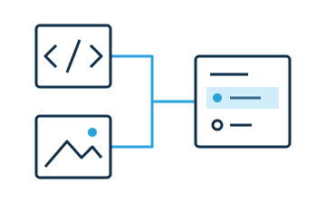
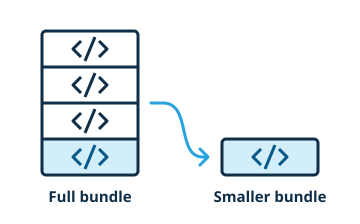

# Manage dependencies

A widget can use native web APIs or a framework that produces a browser-ready custom element. It can include styles and media, and it can share compatible dependencies with other widgets. It can load optional features when readers need them and select which features an offline export includes.



<!-- library:vanilla -->
The [tutorial](../tutorial/index.md) uses [`HTMLElement`](https://developer.mozilla.org/en-US/docs/Web/API/HTMLElement) in its **JS** version. The library selector also offers [Lit](https://lit.dev/docs/components/overview/).
<!-- /library -->
<!-- library:lit -->
The [tutorial](../tutorial/index.md) uses `LitElementWw`. This base class gives access to edit mode, inherited language changes, and scoped data. Select **JS** in the library selector for the example that uses `HTMLElement` directly.
<!-- /library -->

<!-- library:react -->
The tutorial uses JSX function components, React hooks, and [`createRoot`](https://react.dev/reference/react-dom/client/createRoot) inside a native custom element. Mount the React component in the shadow DOM. Unmount it when the widget disconnects. Before publication, use the build script to compile JSX and bundle the CommonJS modules for React and React DOM.
<!-- /library -->
<!-- library:vue -->
The tutorial uses Vue single-file components with `<script setup>`, `<template>`, and `<style>`. The registration module calls [`defineCustomElement`](https://vuejs.org/api/custom-elements#definecustomelement). The build scripts compile the component in custom-element mode. They also include the shadow styles and bundle Vue.
<!-- /library -->
<!-- library:angular -->
The tutorial uses [Angular Elements](https://angular.dev/guide/elements) with shadow encapsulation and a native slot. Its TypeScript classes use `@Component` and `@Input` decorators. The build script compiles TypeScript. It also bundles the Angular runtime and template compiler. The authoring tool loads the browser-ready modules.
<!-- /library -->
<!-- library:svelte -->
The tutorial uses the [Svelte custom-element compiler](https://svelte.dev/docs/svelte/custom-elements). The build script compiles `.svelte` components and bundles their runtime. The authoring tool loads the browser-ready modules.
<!-- /library -->

Declare framework dependencies in [`dependencies`](https://docs.npmjs.com/cli/v11/configuring-npm/package-json/#dependencies). Use bare module specifiers to import them. The build scripts compile the source files and bundle the runtime when necessary.

<!-- library:vanilla -->
```js
import {LitElement, html} from "lit"
```
<!-- /library -->
<!-- library:lit -->
```js
import {LitElementWw} from "@webwriter/lit"
import {html} from "lit"
```
<!-- /library -->
<!-- library:react -->
```js
import {useState} from "react"
import {createRoot} from "react-dom/client"
```
<!-- /library -->
<!-- library:vue -->
```js
import {defineCustomElement} from "vue/dist/vue.runtime.esm-browser.js"
```
<!-- /library -->
<!-- library:angular -->
```js
import {createCustomElement} from "@angular/elements"
```
<!-- /library -->
<!-- library:svelte -->
```js
import {onMount} from "svelte"
```
<!-- /library -->

`@webwriter/build` bundles dependencies into each widget by default. If the authoring tool supports shared dependencies, use `--shared-dependencies`. The document's import map resolves the imports for compatible dependencies. Use `prebuiltDependencies` for dependencies that must be in the bundle, such as CommonJS code.

<!-- library:lit -->
Declare `@webwriter/lit` and `lit` in `dependencies`. Register third-party shadow components with `static scopedElements` to prevent conflicts with global names.
<!-- /library -->

Render the widget interface in the shadow DOM.

Export document-level CSS separately. For example, a field guide can use `./widgets/ww-field-guide.*` for its script and stylesheet. Include the theme if the component library requires one.

Use a module-relative URL for a file in the same package as the module.

```js
const imageUrl = new URL("./fern.svg", import.meta.url).href
```

Include the file in the published package. Check that the file loads in preview and in saved HTML. The offline export can include resources that it can resolve from the package. Other network requests still require network access. See the [package manifest reference](../reference/distribution.md).

## Optimize the code bundle

Use [`import()`](https://developer.mozilla.org/en-US/docs/Web/JavaScript/Reference/Operators/import) to load large optional features when readers need them. Offline HTML usually includes these modules so they can run without a network connection. If saved settings restrict the available features, use `static offlineImports(element)` to select the necessary modules and dependencies.



### Put optional features behind lazy imports

Put the optional features in a separate loader module. Use a literal module specifier in each `import()` call. In this example, `widgets/ww-simulation.js` is the widget entry. `simulations/loaders.js` contains the loaders.

```js
// simulations/loaders.js
export const loaders = {
  orbits: () => import("./orbits.js"),
  circuits: () => import("./circuits.js"),
}
```

### Select imports from the saved widget

Use the same rule to select features when the widget loads and when the document exports. The authoring tool calls the hook synchronously with a detached copy of the saved element. Read its attributes or light-DOM children. Keep the copy unchanged.

```js
// widgets/ww-simulation.js
import {loaders} from "../simulations/loaders.js"

const simulationType = element => element.getAttribute("type") ?? "orbits"

class WwSimulation extends HTMLElement {
  static offlineImports(element) {
    const type = simulationType(element)
    return [{
      importer: "../simulations/loaders.js",
      keep: Object.hasOwn(loaders, type) ? [`./${type}.js`] : [],
    }]
  }

  async loadSimulation() {
    const type = simulationType(this)
    if (Object.hasOwn(loaders, type)) return loaders[type]()
  }
}

customElements.define("ww-simulation", WwSimulation)
```

`importer` identifies the file with the `import()` calls relative to the published widget entry. Each `keep` value matches a specifier in one of those calls. For example, `./orbits.js` is relative to `loaders.js`. Make sure that the published package keeps the loader module and its dynamic imports. The build can also put code directly in a module. In that case, the code is part of that module.

The offline export includes the selections for each widget instance and insertable template. A document with an Orbits widget and a Circuits widget contains both simulations. Include all modes that readers can select offline. Return `keep: "*"` if readers need all modes. See the [runtime interface](../reference/runtime.md#offline-imports).

### Verify the offline export

1. Load the built widget in the authoring tool.
2. Select one variant.
3. Set a value that you can identify when you open the document again.
4. Save the document as **Offline HTML**.
5. Open the file in a browser with the network disabled.
6. Make sure that the selected variant starts and restores the saved state and settings.
7. Compare the file size with a document that includes all variants.
8. If an import fails with `OfflineImportError`, show a message that explains which variants are available offline.

## Dependency requirements in the manifest

## Files and styles in the published package
