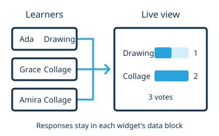

# Support live sessions

A widget can give authors control over optional participant interactions in a live session. It can collect responses that participants submit from the reader. Hosts can see individual responses or compare them in an aggregated view.



## Let authors choose what participants can do

Declare `static permissions` to give the author control over an optional interaction. For example, an author can give workshop participants access to a glossary.

<iframe title="Workshop activity with an optional participant glossary" src="../examples/preview.html?guide=live-sessions" width="100%" height="360" loading="lazy"></iframe>

[Open the participant controls demo](../examples/preview.html?guide=live-sessions) · [View the example source](../examples/guide-live-sessions.js)

The author checkbox adds or removes `allow-glossary` on the widget. Open the glossary in the participant view. Clear **Allow glossary**. Make sure that the glossary closes and that the control disappears.

1. Select the widget in the authoring tool.
2. Open **Distribute**.
3. Open the permissions drawer for the selected widget.
4. Under **Permissions**, select **Allow glossary** below **Edit**.
5. Start a live session from **Preview**.
6. Join the live session as a participant.
7. Make sure that the glossary control is available.

**Allow glossary** works independently of **Edit**. It is available when **View** is on.

Use the Boolean property name as the key in the declaration. Specify the HTML attribute for that property. The authoring tool adds an empty attribute when the author selects the checkbox. It removes the attribute when the author clears the checkbox. Reflect the widget property to the attribute. Observe attribute changes to update the participant view.

```js
static permissions = {
  allowGlossary: {
    attribute: "allow-glossary",
    label: {_: "Allow glossary"},
    description: {_: "Let participants open a glossary during the activity."},
  },
}

static observedAttributes = ["allow-glossary"]

get allowGlossary() {
  return this.hasAttribute("allow-glossary")
}

set allowGlossary(value) {
  this.toggleAttribute("allow-glossary", Boolean(value))
}
```

In `attributeChangedCallback()`, use `this.allowGlossary` to set the visibility of the glossary. In authored HTML, `<ww-workshop-glossary allow-glossary>` enables it. See the [element permissions reference](../reference/options-actions.md#element-permissions).

These flags control the interactions in the widget. The authoring tool sets the permissions for document edits. A service that the widget calls must do its own authorization checks.

## Save participant responses

Store participant data in a direct data block. Set `sharedData: true` in the [editing configuration](../reference/editing-configuration.md). A workshop poll, for example, can store each participant's vote in this block.

```html
<ww-workshop-poll>
  <p>Choose the next workshop activity.</p>
  <script type="application/json" slot="data">{"activity":""}</script>
</ww-workshop-poll>
```

For separate data per participant, omit `shared`. Use the [participant data guide](sharing.md) to select a sharing scope. Set up the data handlers. Wait for the data to be ready before you write. Show accepted changes without writing them again. The poll's aggregated view reads the response data from the widget snapshot.

## Submit responses from the reader

Set `static formAssociated = true` on the custom element class to include the widget in **Submit**. An HTML form can group widgets and standard inputs for validation.

```html
<form>
  <ww-workshop-poll name="activity" required>
    <p>Choose the next workshop activity.</p>
    <script type="application/json" slot="data">{"activity":""}</script>
  </ww-workshop-poll>
</form>
```

Use [`ElementInternals.setValidity()`](https://developer.mozilla.org/en-US/docs/Web/API/ElementInternals/setValidity) to report invalid input, such as a missing selection. Forward `reportValidity()` to let the reader show the validation message. For standard HTML forms, give the widget a `name`. Use [`ElementInternals.setFormValue()`](https://developer.mozilla.org/en-US/docs/Web/API/ElementInternals/setFormValue) to supply its response. For multiple values, pass [`FormData`](https://developer.mozilla.org/en-US/docs/Web/API/FormData) with one entry for each selected option.

When the participant confirms, the reader adds the Boolean `submitted` attribute. The reader also dispatches a non-bubbling `submit` event on each participating widget. Use the event to show immediate feedback. Observe the attribute to show feedback when the authoring tool restores a snapshot. Remove the attribute when the response changes. For example, the workshop poll can show “Vote submitted.”

The widget snapshot includes the `submitted` attribute. Keep the response in the data block so the host can read it during the session or in replay.

## Declare an aggregated view

Add `static aggregate` to the widget class. Select a shape for the view. Specify the value to compare. This declaration counts the workshop poll votes.

```js
static aggregate = {
  shape: "selection",
  title: "Activity votes",
  items: [
    {id: "drawing", label: "Drawing"},
    {id: "collage", label: "Collage"},
  ],
  value: data => data?.activity || undefined,
}
```

Return `undefined` from `value` to omit a sample with no selection. Set `reference` to mark a comparison value. An `aggregate` function receives read-only snapshots. It can use them to set labels and the reference value.

Return an array of configurations to supply several views for a widget. Give each configuration a `title`. Give each configuration a stable `id`. If you omit the ID, the authoring tool uses the shape name. The host selects a view with the widget's live session selector.

The [Aggregated View reference](../reference/aggregated-view.md) lists the seven shapes and their inputs. Select `custom` for widget-specific graphics. Register a separate element that receives the aggregate context.

## Check the live view

Start a live session from **Preview**. Join the session as several participants. Submit a different response as each participant. The host can select a declared view, **Thumbnail wall**, or an individual participant. The authoring tool shows participant thumbnails if it has no declaration or the declaration fails.

Change the participant filter. Make sure that the chart shows the new selection. Select a time in replay. Check that replay shows the responses for that time. Test missing responses, remote data changes, undo, and redo. Shared data supply one response for each shared scope.

Keep aggregate rendering read-only. Test a custom renderer in a narrow container. Disconnect its observers and remove its listeners when the renderer disconnects.

## Participant permissions and controls

## Response checks during replay
