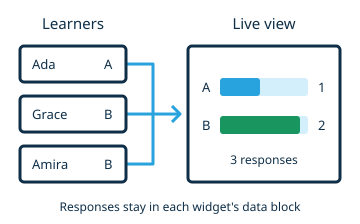

# Support live sessions

Let a host see how learners are using your widget, either as individual snapshots
or as an aggregated view of their responses.



## Save participant responses

Store persistent answers in a direct data block, and enable `sharedData: true` in
the widget's [editing configuration](../reference/editing-configuration.md):

```html
<ww-quiz answer="false">
  <p>The Moon is a star.</p>
  <script type="application/json" slot="data">{"choice":""}</script>
</ww-quiz>
```

Leave `shared` absent when each learner should answer independently. Use the
[participant data guide](sharing.md) to choose a sharing mode and implement data
handlers. Wait for ready data before writing, and render accepted changes without
writing them back. Live sessions capture those changes, including remote updates
and undo or redo; temporary properties and shadow DOM are not the aggregation
interface.

## Declare an aggregated view

Add `static aggregate` to your widget class. Choose a shape and extract the
response you want to compare. This declaration works with the quiz above:

```js
static aggregate = context => ({
  shape: "selection",
  title: "Class answers",
  items: [
    {id: "true", label: "True"},
    {id: "false", label: "False"},
  ],
  value: data => data?.choice || undefined,
  reference: context.widget.attributes.answer,
})
```

Returning `undefined` from `value` leaves unanswered samples out of the chart. Declare the
correct answer explicitly with `reference`; the data block's initial value is
only a starting state. The function receives read-only snapshots, so it can
adapt labels and the reference to the authored widget without changing it.

Return an array of configurations to offer several views of one widget. Give
each configuration a `title` and a stable `id` (the shape name is the default ID).
The host selects a view in the widget's live-session selector.

The [Aggregated View reference](../reference/aggregated-view.md) lists the seven
shapes and their inputs. For widget-specific graphics, choose `custom` and
register a separate rendering element that receives the aggregate context.

## Check the live view

Start a live session from **Preview**, join as several learners, and submit
different answers. The host can choose a declared aggregated view, **Thumbnail
wall**, or an individual learner for each widget. Without a declaration, or if one fails,
WebWriter shows learner thumbnails.

Check that changing the learner filter updates the chart and that replay shows
the responses at the selected time. Also try unanswered responses, remote data
changes, and undo or redo. Shared answers contribute one response per shared
scope rather than one duplicate per learner.

Keep aggregate rendering read-only. WebWriter places its views in the shadow
appendix, and aggregation does not change the widget's data, history, or exported
HTML. For a custom renderer, check narrow containers and clean up observers and
listeners when the renderer disconnects.
