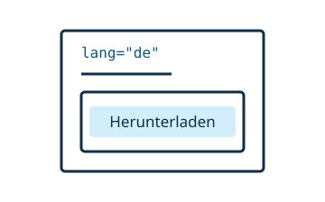

# Localize a widget

A widget can use its own language setting or the language of the document. It can update the text when the language changes. The authoring tool can translate option and action labels while the saved values stay the same.



<!-- live-example: Localized greeting -->

```js vanilla
class LocalizedGreeting extends HTMLElement {
  static observedAttributes = ["lang"]

  constructor() {
    super()
    this.attachShadow({mode: "open"})
  }

  connectedCallback() {
    this.render()
  }

  attributeChangedCallback() {
    this.render()
  }

  render() {
    const german = this.lang.toLowerCase().startsWith("de")
    this.shadowRoot.innerHTML = `
      <style>
        :host { display: block; }
        section { display: grid; justify-items: start; gap: .5rem; padding: .75rem; border: 1px solid #b8c7d6; border-radius: .5rem; }
      </style>
      <section lang="${german ? "de" : "en"}">
        <strong>${german ? "Guten Morgen!" : "Good morning!"}</strong>
        <button type="button">${german ? "Sprache wechseln" : "Change language"}</button>
      </section>`
    this.shadowRoot.querySelector("button").addEventListener("click", () =>
      this.lang = german ? "en" : "de")
  }
}

customElements.define("ww-localized-greeting", LocalizedGreeting)
```

```html
<ww-localized-greeting lang="en"></ww-localized-greeting>
```

<!-- /live-example -->

<!-- library:vanilla -->
Read the nearest [`lang`](https://developer.mozilla.org/en-US/docs/Web/HTML/Reference/Global_attributes/lang) attribute on the widget or one of its ancestors.

```js
const locale = this.closest("[lang]")?.getAttribute("lang") || "en"
const language = locale.toLowerCase().split("-")[0]
const downloadLabel = language === "de" ? "Herunterladen" : "Download"
```

Update labels when the language changes on the widget or an ancestor. Call `disconnect()` on the language observer when the widget disconnects.

<!-- /library -->
<!-- library:lit -->
`LitElementWw` provides a reactive `lang` property. It uses the widget's `lang` value if one exists. Otherwise, it uses the language of the nearest ancestor with a language setting. Read `lang` in `render()`.

```js
render() {
  const language = this.lang.toLowerCase().split("-")[0]
  const downloadLabel = language === "de" ? "Herunterladen" : "Download"
  return html`<button>${downloadLabel}</button>`
}
```

Import `html` from `lit`. The base class updates the template when the language changes. In a project that uses [`@lit/localize`](https://lit.dev/docs/localization/overview/), set `this.localize` to `{getLocale, setLocale}` in the constructor.
<!-- /library -->

Use translated labels for the options and actions in the authoring tool.

```js
static options = {
  speaker: {type: String, label: {_: "Speaker", de: "Sprechername"}},
}
```

`LocalizedText` supports a locale, a language, and an `_` fallback. Keep the same option values and attribute names in all languages.

<!-- library:lit optional -->
For a project that uses `@lit/localize`, run `npx @webwriter/build localize`. Build the widget again. The command can also translate snippets and metadata. See the [build commands](../reference/build-test.md).
<!-- /library -->

## Language selection and fallback

## Checks after a language change
