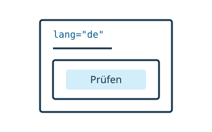

# Localize a widget

Widgets should follow the document's language.



<!-- library:vanilla -->
Read the closest `lang` attribute, including one set on the widget itself:

```js
const locale = this.closest("[lang]")?.getAttribute("lang") || "en"
const language = locale.toLowerCase().split("-")[0]
const checkLabel = language === "de" ? "Prüfen" : "Check"
```

Update labels when the widget's or an ancestor's language changes. Pair any language observer with `disconnect()` when the widget disconnects.

<!-- /library -->
<!-- library:lit -->
`LitElementWw` provides a reactive `lang` property that follows the nearest ancestor's language unless explicitly set on the widget. Read it in `render()`:

```js
render() {
  const language = this.lang.toLowerCase().split("-")[0]
  const checkLabel = language === "de" ? "Prüfen" : "Check"
  return html`<button>${checkLabel}</button>`
}
```

Import `html` from `lit`. The base updates the template when effective language changes and cleans up its observers on disconnection. For a configured `@lit/localize` project, assign its `{getLocale, setLocale}` functions to `this.localize` in the constructor.
<!-- /library -->

Use localized labels for editor options and actions:

```js
static options = {
  answer: {type: String, label: {_: "Answer", de: "Antwort"}},
}
```

`LocalizedText` supports an exact locale, a language, and an `_` fallback. Do not translate stored option values or attribute names.

For a project configured with `@lit/localize`, run `npx @webwriter/build localize` and rebuild. The command also supports snippet and metadata translations. See [build commands](../reference/build-test.md).
