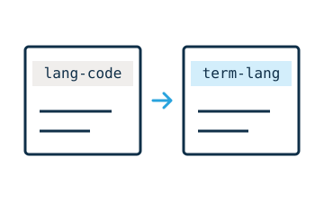

# Migrate widget content

Export `./migrate.js` to update older widget HTML when it is pasted, dropped, or inserted from a snippet. The migration runs in a sandbox, outside the live document.



For example, a glossary widget can rename the attribute that stores a term’s language while preserving the authored definition.

```js
document.addEventListener("migrate", event => {
  const widget = event.target
  if(widget.localName !== "ww-glossary" || !widget.hasAttribute("lang-code")) return
  if(!widget.hasAttribute("term-lang")) {
    widget.setAttribute("term-lang", widget.getAttribute("lang-code"))
  }
  widget.removeAttribute("lang-code")
})
```

This example renames one attribute and preserves all other content. It is safe to run again because the old attribute is gone.

`event.detail` contains `{packageName, version}` for the installed package. Inspect the incoming element for its old format. Finish within three seconds, and do not depend on application state outside the sandbox.

Test old, current, and irregular but valid HTML. Preserve unrelated attributes, namespaces, children, and comments. See the [distribution reference](../reference/distribution.md).
