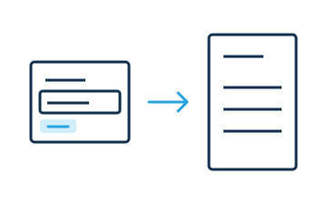

# Support printing

A widget can show a [print view](https://developer.mozilla.org/en-US/docs/Web/CSS/Guides/Media_queries/Printing) that keeps important information easy to read on paper. It can show content that normally needs input and hide controls that require a screen. It can also give readers a way to complete an activity on paper.



```css
/* In the widget's shadow styles */
.paper-notes { display: none; }

@media print {
  .entry-controls { display: none; }
  .paper-notes {
    display: block;
    min-block-size: 3rem;
    border-block-end: 1px solid currentColor;
  }
}
```

Add a `.paper-notes` element in the shadow DOM. Give it a label such as “Observations.” If the print view needs a script, listen for [`beforeprint`](https://developer.mozilla.org/en-US/docs/Web/API/Window/beforeprint_event) and [`afterprint`](https://developer.mozilla.org/en-US/docs/Web/API/Window/afterprint_event) on `window`. Remove the listeners when the widget disconnects.

Use print preview. Check the text, borders, and page breaks. If the widget has no print view, show a short explanation on paper.

## Content and controls on paper

## Page breaks and print checks
