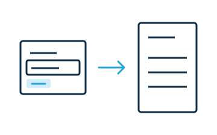

# Support printing

A widget can show a [print view](https://developer.mozilla.org/en-US/docs/Web/CSS/Guides/Media_queries/Printing) that keeps important information easy to read on paper. It can show content that normally needs input and hide controls that require a screen. It can also give readers a way to complete an activity on paper.



Select **Preview print view** to swap the screen input for a line for handwritten notes. The button switches a class in the widget's own shadow DOM. The editor shows the same view with the class `ww-beforeprint` on the widget while the document is printed.

<!-- live-example: Print friendly notes -->

```js vanilla
class PrintNotes extends HTMLElement {
  constructor() {
    super()
    this.attachShadow({mode: "open"}).innerHTML = `
      <style>
        :host { display: block; }
        section { padding: .75rem; border: 1px solid #b8c7d6; border-radius: .5rem; }
        .preview-controls { margin-block-end: .6rem; }
        .paper-notes { display: none; min-block-size: 3rem; border-block-end: 1px solid currentColor; }
        :host(.ww-beforeprint) .entry-controls, .print-view .entry-controls { display: none; }
        :host(.ww-beforeprint) .paper-notes, .print-view .paper-notes { display: block; }
        @media print {
          .entry-controls, .preview-controls { display: none; }
          .paper-notes { display: block; }
        }
      </style>
      <section>
        <div class="preview-controls"><button type="button" aria-pressed="false">Preview print view</button></div>
        <slot></slot>
        <label class="entry-controls">Observation <input type="text"></label>
        <div class="paper-notes">Observation:</div>
      </section>`
    const section = this.shadowRoot.querySelector("section")
    const button = this.shadowRoot.querySelector("button")
    button.addEventListener("click", () => {
      button.setAttribute("aria-pressed", String(section.classList.toggle("print-view")))
    })
  }
}

customElements.define("ww-print-notes", PrintNotes)
```

```html
<ww-print-notes>
  <strong>Trail observation log</strong>
  <p>Record one detail from the walk.</p>
</ww-print-notes>
```

<!-- /live-example -->

```css
/* In the widget's shadow styles */
.paper-notes { display: none; }

@media print {
  .entry-controls { display: none; }
  .paper-notes {
    display: block;
    min-block-size: 3rem;
    border-block-end: 1px solid currentColor;
  }
}

/* The same view while the editor prints or previews the document */
:host(.ww-beforeprint) .entry-controls { display: none; }
:host(.ww-beforeprint) .paper-notes { display: block; min-block-size: 3rem; }
```

Add a `.paper-notes` element in the shadow DOM. Give it a label such as “Observations.” If the print view needs a script, listen for [`beforeprint`](https://developer.mozilla.org/en-US/docs/Web/API/Window/beforeprint_event) and [`afterprint`](https://developer.mozilla.org/en-US/docs/Web/API/Window/afterprint_event) on `window`. Remove the listeners when the widget disconnects.

## The class `ww-beforeprint`

While the document is printed, the editor adds the class `ww-beforeprint` to every installed widget element, and removes it afterwards. The class is present between `beforeprint` and `afterprint`, in the print preview of the editor, and while the `print` media query matches. A widget that is added while the document is printed gets it too.

- Style with `:host(.ww-beforeprint)` for rules that must also apply in a preview. Use `@media print` for the paper itself. Write both rules, as the example does.
- Read it in a script with `this.classList.contains("ww-beforeprint")`, or watch the `class` attribute with a [`MutationObserver`](https://developer.mozilla.org/en-US/docs/Web/API/MutationObserver). A script that only has to prepare for paper can listen for `beforeprint` instead.
- The class is runtime state, like the `contenteditable` that the editor adds while the author edits. It is not saved, not shared with collaborators, and not part of undo history. Do not add or remove it yourself, and do not select on it in the authored content. Other classes of the widget stay as the author wrote them.
- A page that was exported or published has no editor and no class. It still has `@media print` and the `beforeprint` and `afterprint` events.

## Content and controls on paper

Decide for each part of the widget what the reader needs on paper.

- **Hide controls that need a screen.** Buttons, sliders, menus, playback bars, and hints such as “Drag to reorder” do nothing on paper. Hide them in `@media print` and `:host(.ww-beforeprint)`.
- **Show what the reader entered or chose.** A text field prints its value in a box, but a long value is cut. Show the value as text, or a line for handwriting when the learner is meant to fill it in by hand, as the example does.
- **Show the state at one moment.** An animation, a timer, and a hover or focus state have no meaning on paper. Draw the state that explains the content. Open a collapsed part when its content matters. Replace a video or audio player with its caption and its address.
- **Do not rely on color or backgrounds.** Browsers leave backgrounds out by default, and many printers are black and white. Mark states with a border, a pattern, or text as well. Set [`print-color-adjust: exact`](https://developer.mozilla.org/en-US/docs/Web/CSS/print-color-adjust) only on what must keep its fill.
- **Use dark text on a light page.** A widget that follows a dark theme sets the theme colors back in `@media print`.
- **Fit the page.** Use `max-inline-size: 100%` and sizes in `em` or `rem`. A fixed width or a height in `vh` breaks across pages. Let a scrollable area grow to show all its content.
- **Make links readable.** Show the address of a link that carries information, for example with `a[href]::after { content: " (" attr(href) ")"; }` in the widget's styles.
- **Say when there is no print view.** If the widget cannot give a useful picture of itself on paper, show a short note that says so and where to find the interactive version. The shared note does this in the document's language and shows the address of the document where it is known. It is shown on paper only.

```ts
import {LitElementWw} from "@webwriter/lit"
import {PrintNote} from "@webwriter/lit/print"

class WwSimulation extends LitElementWw {
  #note = new PrintNote(this)
  // …
}
```

`PrintNote` adds `<p data-ww-print-note>` at the end of the shadow root. Put that element in the template to choose its place. The note uses the `ww-beforeprint` class and `@media print` itself, so no rule is needed. The address is the `<link rel="canonical">` of the page, or the address of a page that is published on the web. A page in the editor or on a local file shows no address. Pass `{address: "https://…"}` to set it, or `{address: null}` to leave it out. The other libraries have the same module: `usePrintNote` in React and Vue, `printNoteStore` in Svelte, and `injectPrintNote` in Angular. See [Print note](../reference/lit.md#print-note).

## Canvases and drawings on paper

A `<canvas>` with a [WebGL](https://developer.mozilla.org/en-US/docs/Web/API/WebGL_API) context prints blank, or as it was last shown, at the resolution of the screen: 96 pixels per inch. A drawing that is made of SVG or HTML prints as vectors and text, so nothing is needed. For a canvas, copy a picture at print resolution when printing starts, and show it in the canvas's place until printing ends.

- Start in two places. Listen for `beforeprint` and `afterprint` on `window`. Also listen for the `change` event of [`matchMedia("print")`](https://developer.mozilla.org/en-US/docs/Web/API/Window/matchMedia), because printing to PDF without a window, as a test or a server does, sends no `beforeprint`. The class `ww-beforeprint` is a third signal for a widget that watches its own attributes. Make the start idempotent: two signals for one print must not make two pictures.
- Draw once more at about 300 pixels per inch, three times the CSS size, within the limits of the browser: a canvas of more than 16 000 pixels on a side or about 100 million pixels in all fails. Copy the result to a 2D canvas in the same task as the drawing, because the buffer of a WebGL canvas is cleared after it is shown.
- Show the copy and hide the live canvas. Undo both on `afterprint`, and draw at screen resolution again.
- A canvas that has lost its context to save memory has nothing to draw with. Keep the last picture when you give a context back, and print that.

```js
const media = matchMedia("print")
let paper = null

function startPrint() {
  if (paper) return
  paper = capture(canvas, 3)          // draw at 3x and copy to a 2D canvas
  canvas.after(paper)
  canvas.hidden = true
}

function endPrint() {
  paper?.remove()
  paper = null
  canvas.hidden = false
}

window.addEventListener("beforeprint", startPrint)
window.addEventListener("afterprint", endPrint)
media.addEventListener("change", event => (event.matches ? startPrint() : endPrint()))
```

A widget that draws with Scene needs none of this. `ww-scene` and `PixiScene` follow `beforeprint`, `afterprint`, the `print` media query, and the class `ww-beforeprint`. The SVG renderer prints as vectors. `PixiScene` draws at 300 pixels per inch and shows that picture in place of its canvas while the document is printed, and a scene that is off screen prints the last picture it showed. `scene.printing` tells a widget that it is happening. To save a picture of a scene as a file, use `toSVG()` or `toImage()`. See [Picture and print](../reference/lit.md#picture-and-print).

## Page breaks and print checks

The browser cuts the document into pages. Tell it where a widget may be cut.

- Keep a small widget in one piece with [`break-inside: avoid`](https://developer.mozilla.org/en-US/docs/Web/CSS/break-inside) on the host, or on each part that must not split, such as one figure, one question, or one table row.
- Let a long widget break between its parts. Put `break-inside: avoid` on the parts, and `break-after: avoid` on a heading so that it stays with what follows.
- Do not force a page break from a widget with `break-before: page`. The author decides where pages begin. The page size, margins, and `@page` rules belong to the document, not to a widget.
- Do not use `position: fixed` or `sticky`, a height in `vh`, or `overflow: hidden` on content that matters. They repeat, cut, or hide content on every page.
- A widget that is wider than the page is cut at the edge. Check the widget at the width of a page, about 700 CSS pixels.

Check each widget before you publish it.

1. Open the document in the editor and print it, or use the print preview. Read every widget. The text, borders, and images must all be there, and no control that needs a screen.
2. Look at each widget at a page break. No part may be cut in the middle of a line, a figure, or a question.
3. Check with a dark theme, and in black and white. Print the page as a PDF and look at it in grayscale.
4. Check the canvases. They must show the drawing, sharp at the printed size, and not a blank box.
5. Check with `@media print` emulated, which browser developer tools offer in their rendering options, and from a script. A test can send the events that the browser sends: `window.dispatchEvent(new Event("beforeprint"))`, and the same with `afterprint`. A test that prints to PDF without a window sends no `beforeprint`, so it also covers the `print` media query.
