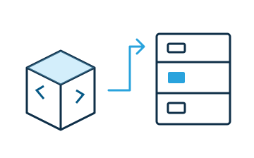

# Publish a widget

Before publishing, load the widget from a local folder and complete the [widget checks](testing.md).



## Package and publish

1. Set a scoped package name, a SemVer version, and the `webwriter-widget` keyword.
2. Export `./widgets/<tag-name>.js` or `./widgets/<tag-name>.*`. The script must define the same tag.
3. Build if your source needs compilation: `npx @webwriter/build`.
4. Run `npm pack --dry-run` and check that scripts, styles, assets, and configuration are included. The published embed pins a package version; include every module, asset, and runtime dependency it needs, and declare dependencies in the manifest.
5. Sign in to npm and run `npm publish --access public`.

For example, an origami viewer can publish a `./widgets/ww-origami-viewer.*` export and include its fold diagrams in the package. Add a short `README.md`, a description, author information, and a license so authors can understand your widget. After publishing, search for the widget in WebWriter and insert it into a fresh document.

For updates, increase the version and provide a [migration](migrations.md) when saved content needs to change. See [distribution metadata](../reference/distribution.md) for export conventions and discovery keywords.

## Embed on another site

Load the widget’s browser-ready module on the host page and insert its custom element. For example, a field journal can keep a short note in an inert JSON data block. In a standalone page, `WidgetDrawer` can save that data to this browser or to an HTTP endpoint. Each embed needs a stable, unique `id` so browser storage can find its result again after reload or when the embed moves.

Bundle the widget’s dependencies into browser-ready modules. If the module retains bare imports such as `@webwriter/lit`, load an import map that resolves them before loading the widget.

```html
<script type="module" src="./widgets/ww-field-journal.js"></script>
<ww-field-journal id="garden-notes" standalone>
  <script type="application/json" slot="data">{"note":"Watch the first crocus open."}</script>
</ww-field-journal>
```

The widget reads and writes through `LitElementWw`'s data lifecycle, and places the real drawer in its scoped registry:

```js
import {LitElementWw, WidgetDrawer} from "@webwriter/lit"
import {html} from "lit"

class WwFieldJournal extends LitElementWw {
  static scopedElements = {"ww-widget-drawer": WidgetDrawer}
  static properties = {note: {state: true}}

  constructor() {
    super()
    this.note = ""
  }

  dataChanged(rawText) {
    try { this.note = JSON.parse(rawText || "{}").note || "" }
    catch { this.note = "" }
  }

  save(event) {
    if(!this.dataReady || this.editable) return
    const data = JSON.parse(this.data || "{}")
    this.data = JSON.stringify({...data, note: event.target.value})
  }

  render() {
    return html`
      <label for="note">Field note</label>
      <textarea id="note" .value=${this.note} @input=${this.save}></textarea>
      <ww-widget-drawer .widget=${this}></ww-widget-drawer>`
  }
}

customElements.define("ww-field-journal", WwFieldJournal)
```

Write a note and reload the preview to see it restored from this browser.

[Open the standalone preview](../examples/preview.html?guide=publishing) · [View the example source](../examples/guide-publishing.js)

<iframe title="Standalone field journal" src="../examples/preview.html?guide=publishing" width="100%" height="360" loading="lazy"></iframe>

An empty `standalone` value selects browser storage. To start with a remote destination, set it to the endpoint URL instead. The drawer restores the destination's saved result; it does not copy data when switching destinations. For endpoint request and concurrency requirements, see [standalone result storage](../reference/standalone.md#http-endpoint). Browser storage belongs to the current browser profile and is not a substitute for an authenticated server when results must follow a learner across devices.
