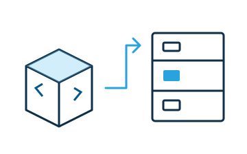

# Publish a widget

Before publishing, load the widget from a local folder and complete the [widget checks](testing.md).

1. Set a scoped package name, a SemVer version, and the `webwriter-widget` keyword.
2. Export `./widgets/<tag-name>.js` or `./widgets/<tag-name>.*`. The script must define the same tag.
3. Build if your source needs compilation: `npx @webwriter/build`.
4. Run `npm pack --dry-run` and check that scripts, styles, assets, and configuration are included.
5. Sign in to npm and run `npm publish --access public`.

Add a short `README.md`, a description, author information, and a license so authors can understand your widget. After publishing, search for the widget in WebWriter and insert it into a fresh document.

For updates, increase the version and provide a [migration](migrations.md) when saved content needs to change. See [distribution metadata](../reference/distribution.md) for export conventions and discovery keywords.
