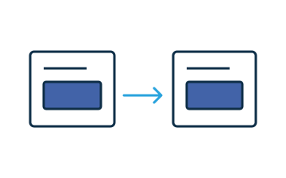

# Make data reactive

A widget can publish read-only signals for other widgets in the same document. Authors can select a source and save the connection in the document. The receiving widget can change its display or operation when the value changes.



Change the source color. Select **Disconnected** to stop updates, then select **Palette color** to reconnect to the current value.

<!-- live-example: Reactive color swatch -->

```js vanilla
import {computed, LitElementWw, signal} from "@webwriter/lit"
import {html} from "lit"

class ColorSource extends HTMLElement {
  #color = signal("#4263a8")
  signals = {color: computed(() => this.#color.get())}

  constructor() {
    super()
    const root = this.attachShadow({mode: "open"})
    root.innerHTML = '<label>Source color <input type="color" value="#4263a8"></label>'
    root.querySelector("input").addEventListener("input", event => {
      this.#color.set(event.currentTarget.value)
    })
  }
}

class LinkedSwatch extends LitElementWw {
  #source = signal(null)

  static effects = {
    "color-from": {
      label: "Swatch color",
      connect(source, lifetime) {
        this.#source.set(source)
        lifetime.addEventListener("abort", () => this.#source.set(null), {once: true})
      },
    },
  }

  render() {
    const color = this.#source.get()?.get()
    const connected = this.hasAttribute("color-from")
    return html`
      <label>Swatch source
        <select @change=${event => {
          const value = event.currentTarget.value
          if(value) this.setAttribute("color-from", value)
          else this.removeAttribute("color-from")
        }}>
          <option value="#palette[color]" ?selected=${connected}>Palette color</option>
          <option value="" ?selected=${!connected}>Disconnected</option>
        </select>
      </label>
      <output style=${color ? `color:${color}` : ""}>${color ?? "Swatch disconnected"}</output>`
  }
}

customElements.define("ww-color-source", ColorSource)
customElements.define("ww-linked-swatch", LinkedSwatch)

// The preview connects the published signal using the saved source ID.
const connections = new Map()
let editing = document.getElementById("preview")?.isContentEditable === true
function updateConnections() {
  if(editing) return
  const receivers = new Set(document.querySelectorAll("ww-linked-swatch"))
  for(const [widget, {source, lifetime}] of connections) {
    const id = /^#(.+)\[color\]$/.exec(widget.getAttribute("color-from"))?.[1]
    if(receivers.has(widget) && document.getElementById(id) === source) continue
    lifetime.abort()
    connections.delete(widget)
  }
  for(const widget of receivers) {
    widget.requestUpdate()
    if(connections.has(widget)) continue
    const id = /^#(.+)\[color\]$/.exec(widget.getAttribute("color-from"))?.[1]
    const source = id && document.getElementById(id)
    if(!source?.signals?.color) continue
    const lifetime = new AbortController()
    LinkedSwatch.effects["color-from"].connect.call(widget, source.signals.color, lifetime.signal)
    connections.set(widget, {source, lifetime})
  }
}

new MutationObserver(updateConnections).observe(document.body, {
  childList: true, subtree: true, attributes: true, attributeFilter: ["color-from", "id"],
})
document.addEventListener("live-example-editing", event => {
  editing = event.detail
  for(const {lifetime} of connections.values()) lifetime.abort()
  connections.clear()
  updateConnections()
})
updateConnections()
```

```html
<ww-color-source id="palette"></ww-color-source>
<ww-linked-swatch color-from="#palette[color]"></ww-linked-swatch>
```

<!-- /live-example -->

## Publish a value

A color picker can store its current color in a private signal. It can publish a stable, read-only [computed signal](https://lit.dev/docs/data/signals/) named `color`. Initialize both signals once for each widget instance.

```js
import {computed, signal} from "@webwriter/lit"

class WwColorSource extends HTMLElement {
  #color = signal("#4263a8")
  signals = {color: computed(() => this.#color.get())}

  set color(value) { this.#color.set(value) }
}
```

Call the setter from the [color input](https://developer.mozilla.org/en-US/docs/Web/HTML/Reference/Elements/input/color)'s `input` handler. For separate builds, use compatible dependencies and [shared dependency builds](libraries.md). Both widgets must use the same Signals implementation.

## Connect a receiver

Declare a `static effects` entry for the receiving attribute. Store the incoming signal. Clear the reference when the authoring tool ends the connection. Read both signals in `LitElementWw.render()` to detect changes to the connection and color.

```js
import {LitElementWw, signal} from "@webwriter/lit"
import {html} from "lit"

class WwLinkedSwatch extends LitElementWw {
  #source = signal(null)

  static effects = {
    "color-from": {
      label: "Swatch color",
      connect(source, lifetime) {
        this.#source.set(source)
        lifetime.addEventListener("abort", () => this.#source.set(null), {once: true})
      },
    },
  }

  render() {
    const color = this.#source.get()?.get()
    return html`<output>${color ?? "Swatch disconnected"}</output>`
  }
}
```

[Register both custom elements](https://developer.mozilla.org/en-US/docs/Web/API/CustomElementRegistry/define). Connect them in the authored HTML. In `#palette[color]`, `palette` is the source widget's unique ID. The public signal name is `color`.

```html
<ww-color-source id="palette"></ww-color-source>
<ww-linked-swatch color-from="#palette[color]"></ww-linked-swatch>
```

Select the swatch in the authoring tool. Select the color picker in **Swatch color** in the Widget drawer. To remove the link, select **Disconnected**.

Change the color in the picker. Make sure that the swatch changes. Disconnect the swatch. Change the color again. Reconnect the swatch. Make sure that it shows the current color.

Make sure that the widget shows a fallback value when the source is missing. The authoring tool restores valid connections when their sources become available. Circular connections stay disconnected. See the [Signals reference](../reference/runtime.md#signals).

## Signal names and dependencies

A signal name is the name in brackets of a link, such as `color` in `#palette[color]`. Use lowercase letters, digits and hyphens, for example `color` or `training-history`. The name is read as a [CSS identifier](https://developer.mozilla.org/en-US/docs/Web/CSS/ident), so the authoring tool escapes other characters. Choose a name that describes the value, not the widget that publishes it. Keep a name once documents use it. Renaming it breaks the saved links.

An effect attribute is a lowercase attribute name that starts with a letter or an underscore and continues with letters, digits, hyphens, underscores or dots. A widget can declare several effects, for example `left-from` and `right-from`. Each effect holds one link.

A published signal depends on the signals its `computed` function reads. Read only signals the widget owns or receives. A computed signal that writes to another signal can start a loop that no declaration shows.

### Value shapes

A signal publishes a value, and the effect that reads it has to know its form. A widget that reads a value it cannot check breaks when another package publishes something else. WebWriter names five standard shapes. Use them where one fits.

| Shape | Value | Guard |
|---|---|---|
| `number` | A finite number. | `isNumber` |
| `string` | A string. | `isString` |
| `boolean` | `true` or `false`. | `isBoolean` |
| `series` | An array of finite numbers, such as a measurement history. | `isSeries` |
| `table` | `{columns: string[], rows: (string \| number \| null)[][]}`. | `isTable` |

Declare the shape of each published signal in `static signals` under the signal's name. An effect lists the shapes it reads in `accepts`.

```js
import {LitElementWw, computed, signal} from "@webwriter/lit"

class WwTrainer extends LitElementWw {
  #history = signal([])
  signals = {history: computed(() => this.#history.get())}

  static signals = {
    history: {
      shape: "series",
      label: "Loss history",
      description: "The loss of each epoch since the page loaded. It is not saved in the document.",
    },
  }
}
```

```js
import {LitElementWw, isSeries, signal} from "@webwriter/lit"

class WwLossChart extends LitElementWw {
  #source = signal(null)

  static effects = {
    "series-from": {
      label: "Series",
      accepts: ["series"],
      connect(source, lifetime) {
        this.#source.set(source)
        lifetime.addEventListener("abort", () => this.#source.set(null), {once: true})
      },
    },
  }

  render() {
    const value = this.#source.get()?.get()
    return isSeries(value) ? this.renderChart(value) : this.renderEmpty()
  }
}
```

The authoring tool lists only sources that declare a shape from `accepts`. A link to another source in the HTML stays unconnected, and the widget drawer says that the shape is not accepted. An effect without `accepts` accepts every signal, and a signal without a declaration stays available to such effects. Existing widgets keep working without changes. A widget that reads a value from an effect without `accepts` checks the value with a guard before it uses it.

Import `isNumber`, `isString`, `isBoolean`, `isSeries`, `isTable` and `hasShape(shape, value)` from `@webwriter/lit`, `@webwriter/widget` or any other helper library. Write a shape of your own, such as `"vector"`, only when no standard shape fits. Name it so that other packages can publish and accept it, and document the value.

### Stored state

A signal reflects the widget's current state. It does not promise that the value survives a reload. Publish a value that the document stores, such as a setting or the data block, as it is stored. A value that exists only while the page runs, such as a training history, may start empty after a reload. Say so in the `description` of the declaration, and make the receiver show its fallback until the first value arrives.

### Publish without Lit

A widget does not need Lit to publish a signal. The source protocol is small: the widget element has a `signals` object, and each entry is an object with a `get()` method and no `set()` method. The authoring tool reads `signals` when it connects a link, so keep the instances stable. A `computed` function or a Lit `render()` that reads a [signal](https://lit.dev/docs/data/signals/) with `get()` follows its changes.

`@webwriter/widget/signals` exports `signal` and `computed` for widgets that do not import Lit. They are the implementation that `@webwriter/lit` re-exports, so a Lit receiver follows a signal created with them. Both widgets must resolve one copy of the Signals polyfill. See [shared dependency builds](libraries.md). A receiver that does not render through Lit uses `watchSignal(source, callback, lifetime)`. It calls the callback with the current value and again after each change until the lifetime aborts.

```js
import {computed, signal, watchSignal} from "@webwriter/widget/signals"

class WwScorePlayer extends HTMLElement {
  #position = signal(0)
  signals = {position: computed(() => this.#position.get())}
  static signals = {position: {shape: "number", label: "Playback position"}}

  static effects = {
    "follow-from": {
      accepts: ["number"],
      connect(source, lifetime) {
        watchSignal(source, value => this.seek(value), lifetime)
      },
    },
  }
}
```

### Test a receiver

Import `connectEffect` from `@webwriter/build/test` to connect an effect for the length of a test. Create the source with `signal` or `computed` from `@webwriter/widget/signals`. `connectEffect(widget, "series-from", source, {shape: "series"})` calls `connect` like the authoring tool does, refuses a shape that `accepts` excludes, and returns `{lifetime, disconnect()}`. Call `disconnect()` to check that the widget clears the source. See [testing](testing.md).

```js
import {connectEffect} from "@webwriter/build/test"
import {signal} from "@webwriter/widget/signals"

const history = signal([1, 2])
const link = connectEffect(chart, "series-from", history, {shape: "series"})
history.set([1, 2, 3])
await chart.updateComplete
link.disconnect()
```

## Missing sources and circular connections

A link is an attribute value in the HTML. The authoring tool keeps it there while the source is missing, and it connects the link when the source appears. A source is missing when no widget has the ID, when the widget does not publish the signal, when two elements share the ID, or when the widget's definition has not loaded yet. The authoring tool connects the link again after a load, an edit, a paste and an undo. A link that is not a selector such as `#sensor[celsius]` stays in the HTML too.

The widget drawer shows the reason below the effect, for example `Signal unavailable: #sensor[celsius]`. The receiver has not been connected, so `connect` has not been called. Show a fallback in this state: an empty value, a placeholder or a short message. Do not hide the widget.

When the source is removed or a link changes, the authoring tool aborts the `lifetime` of the old connection. Clear the stored source in the abort handler. When the link points to a new source, `connect` runs again with the new signal.

A connection is circular when its source depends on the receiver, directly or through other widgets. A widget that receives from `#a[total]` and publishes `total` for `#a` is an example. The authoring tool connects no link of a circle, and it names the path in the drawer, for example `Circular signal connection: sum → average → sum`. Selecting a source that closes a circle is refused. A circle in saved HTML, such as one a collaborator created, stays in the HTML, and the links stay disconnected until one is changed. Break the circle by removing or changing one link.

Do not connect widgets in a circle on purpose, and do not write to a source from a receiver. A receiver only reads.
