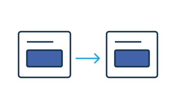

# Make data reactive

A widget can publish read-only signals for other widgets in the same document. Authors can select a source and save the connection in the document. The receiving widget can change its display or operation when the value changes.



## Publish a value

A color picker can store its current color in a private signal. It can publish a stable, read-only [computed signal](https://lit.dev/docs/data/signals/) named `color`. Initialize both signals once for each widget instance.

```js
import {computed, signal} from "@webwriter/lit"

class WwColorSource extends HTMLElement {
  #color = signal("#4263a8")
  signals = {color: computed(() => this.#color.get())}

  set color(value) { this.#color.set(value) }
}
```

Call the setter from the [color input](https://developer.mozilla.org/en-US/docs/Web/HTML/Reference/Elements/input/color)'s `input` handler. For separate builds, use compatible dependencies and [shared dependency builds](libraries.md). Both widgets must use the same Signals implementation.

## Connect a receiver

Declare a `static effects` entry for the receiving attribute. Store the incoming signal. Clear the reference when the authoring tool ends the connection. Read both signals in `LitElementWw.render()` to detect changes to the connection and color.

```js
import {LitElementWw, signal} from "@webwriter/lit"
import {html} from "lit"

class WwLinkedSwatch extends LitElementWw {
  #source = signal(null)

  static effects = {
    "color-from": {
      label: "Swatch color",
      connect(source, lifetime) {
        this.#source.set(source)
        lifetime.addEventListener("abort", () => this.#source.set(null), {once: true})
      },
    },
  }

  render() {
    const color = this.#source.get()?.get()
    return html`<output>${color ?? "Swatch disconnected"}</output>`
  }
}
```

[Register both custom elements](https://developer.mozilla.org/en-US/docs/Web/API/CustomElementRegistry/define). Connect them in the authored HTML. In `#palette[color]`, `palette` is the source widget's unique ID. The public signal name is `color`.

```html
<ww-color-source id="palette"></ww-color-source>
<ww-linked-swatch color-from="#palette[color]"></ww-linked-swatch>
```

Select the swatch in the authoring tool. Select the color picker in **Swatch color** in the Widget drawer. To remove the link, select **Disconnected**.

Change the color in the picker. Make sure that the swatch changes. Disconnect the swatch. Change the color again. Reconnect the swatch. Make sure that it shows the current color.

<iframe title="Reactive color picker and swatch" src="../examples/preview.html?guide=reactivity" width="100%" height="170" loading="lazy"></iframe>

[Open the reactive color example](../examples/preview.html?guide=reactivity) · [Read the complete example source](../examples/guide-reactivity.js)

Make sure that the widget shows a fallback value when the source is missing. The authoring tool restores valid connections when their sources become available. Circular connections stay disconnected. See the [Signals reference](../reference/runtime.md#signals).

## Signal names and dependencies

## Missing sources and circular connections
