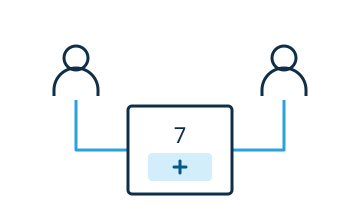

# Share participant data

Widgets can save participant data individually, for everyone, or for a group. A shared tally counter is one example.



Set `sharedData: true` in the widget's [editing configuration](../reference/editing-configuration.md). Add one direct data block to the widget's authored HTML, for example in a snippet:

```html
<ww-counter shared>
  <script type="application/json" slot="data">{"count":0}</script>
</ww-counter>
```

<!-- library:vanilla -->
Listen for `datapending` and `datachange` on the widget. Dispatch a bubbling, cancelable `datarequest` on the current direct data block when the widget connects or replaces that block; the runtime replays its current pending, ready, or error state. `datapending` also fires when a sharing or grouping scope change starts resolving, and `datachange` signals that the accepted state is ready. Check that each event belongs to its current direct data block before reading it. Wait for `datachange` before writing; writes during initial connection can be discarded.

```js
const block = this.querySelector(':scope > script[slot="data"]')
if(block) {
  const state = JSON.parse(block.textContent)
  const count = typeof state.count === "number" ? state.count : 0
  block.textContent = JSON.stringify({...state, count: count + 1})
}
```

Use this write in an interaction after initialization. Render accepted local changes and remote changes from `datachange`; do not write state back while rendering. Handle `dataerror` to show a useful message.

<!-- /library -->
<!-- library:lit -->
Use `LitElementWw`'s `dataPending`, `dataChanged`, and `dataError` methods to handle data updates. Wait for `this.dataReady` before writing through `this.data` from a user interaction. The base handles requests, event filtering, scope changes, and cleanup; the complete example below shows the hooks.
<!-- /library -->

| Attribute | Scope |
|---|---|
| No `shared` | The current participant. |
| `shared` or `shared=""` | Everyone. |
| `shared="group"` | The participant's server-assigned group. |

Switching scope loads the destination scope’s existing data or the authored defaults. The **Share** control exposes grouping where a connected server provides a roster. Preserve any direct `ww-grouping` processing instruction when changing children.

See the [data reference](../reference/data.md) and [working tutorial](../tutorial/06-collaboration.md). The [runtime configuration](../../../README.md#scoped-widget-data) explains server and offline persistence setup.

## Handler methods with LitElementWw

`LitElementWw` supplies listeners, current-state requests, readiness tracking, and cleanup. Implement the hooks and write through `data` from an interaction:

```js
import {LitElementWw} from "@webwriter/lit"
import {html} from "lit"

class WwCounter extends LitElementWw {
  static properties = {count: {state: true}, error: {state: true}}

  constructor() {
    super()
    this.count = 0
    this.error = ""
  }

  dataPending(context) { this.error = "" }

  dataChanged(rawText, context) {
    const value = JSON.parse(rawText || "{}")
    this.count = typeof value.count === "number" ? value.count : 0
    this.error = ""
  }

  dataError(error, context) { this.error = error.message }

  increment() {
    if(!this.dataReady || this.editable) return
    const value = JSON.parse(this.data || "{}")
    const count = typeof value.count === "number" ? value.count : 0
    this.data = JSON.stringify({...value, count: count + 1})
  }

  render() {
    return html`
      <button ?disabled=${!this.dataReady || this.editable} @click=${this.increment}>
        ${this.count}
      </button>
      <output>${this.error}</output>`
  }
}

customElements.define("ww-counter", WwCounter)
```

Use the normal `./widgets/ww-counter` package export with `sharedData: true` in its editing configuration, and authored defaults:

```html
<ww-counter shared>
  <script type="application/json" slot="data">{"count":0}</script>
</ww-counter>
```

Concurrent updates to `count` resolve to one assigned value. In standalone documents without a managed data runtime, the widget uses local authored data. Handlers receive a second `{block, mode}` argument when scope information is needed.
