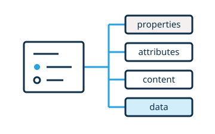

# Manage state

A widget can keep temporary interaction state in memory and save author settings with the document. It can store participant results separately. Authors can use declared options and actions to make changes that the authoring tool can undo.



<!-- live-example: Metronome settings -->

```js vanilla
class GuideMetronome extends HTMLElement {
  static options = {tempo: {type: Number, label: {_: "Tempo"}, min: 40, max: 240}}
  static actions = {resetTempo: {label: {_: "Reset tempo"}}}
  static observedAttributes = ["tempo", "sound"]

  constructor() {
    super()
    this.beat = 0
    this.attachShadow({mode: "open"}).innerHTML = `
      <label>Tempo <input type="range" min="40" max="240" value="96"></label>
      <button type="button">Next beat</button>
      <button type="button">Reset tempo</button>
      <button type="button" aria-expanded="false">Sound details</button>
      <output aria-live="polite"></output>
      <p hidden>Selected sound: <span></span></p>`
    this.tempoInput = this.shadowRoot.querySelector('input[type="range"]')
    this.tempoInput.addEventListener("input", () => this.setAttribute("tempo", this.tempoInput.value))
    this.shadowRoot.querySelector("button").addEventListener("click", () => {
      this.beat = (this.beat + 1) % 4
      this.render()
    })
    this.shadowRoot.querySelectorAll("button")[1].addEventListener("click", () => this.resetTempo())
    this.shadowRoot.querySelectorAll("button")[2].addEventListener("click", event => {
      const details = this.shadowRoot.querySelector("p")
      details.hidden = !details.hidden
      event.currentTarget.setAttribute("aria-expanded", String(!details.hidden))
    })
    this.syncSettings()
  }

  resetTempo() { this.setAttribute("tempo", "120") }
  attributeChangedCallback() { this.syncSettings() }

  syncSettings() {
    this.tempoInput.value = this.tempo
    this.shadowRoot.querySelector("p span").textContent = this.sound
    this.render()
  }

  get tempo() { return Number(this.getAttribute("tempo") ?? 120) }
  set tempo(value) { this.setAttribute("tempo", value) }
  get sound() { return this.getAttribute("sound") ?? "woodblock" }

  render() {
    this.shadowRoot.querySelector("output").textContent =
      `${this.tempo} BPM · Beat ${this.beat + 1} of 4`
  }
}

customElements.define("ww-guide-metronome", GuideMetronome)
```

```html
<ww-guide-metronome tempo="96" sound="woodblock"></ww-guide-metronome>
```

<!-- /live-example -->

Use properties for temporary state. Use attributes for settings that the authoring tool must save, share, and undo. For example, a metronome can save its selected sound in an attribute. It can keep the visibility of sound details in memory.

<!-- library:vanilla -->
```js
get sound() { return this.getAttribute("sound") ?? "woodblock" }
set sound(value) { this.setAttribute("sound", value) }
```

[Observe the attribute](https://developer.mozilla.org/en-US/docs/Web/API/Web_components/Using_custom_elements#responding_to_attribute_changes) to update the display when a collaborator or undo changes its value.

```js
static observedAttributes = ["sound"]

attributeChangedCallback(name, previous, current) {
  if(previous !== current) this.update()
}
```
<!-- /library -->
<!-- library:lit -->
Declare a [reactive property](https://lit.dev/docs/components/properties/) in the `LitElementWw` class. Reflect changes to the property in an attribute.

```js
static properties = {sound: {type: String, reflect: true}}

constructor() {
  super()
  this.sound = "woodblock"
}
```

Lit updates the template after an attribute change. This includes changes from collaboration and undo. Use `{state: true}` for local reactive properties that have no attribute.
<!-- /library -->

<!-- library:react -->
Keep saved settings on the custom element host. The bridge reads the `sound` attribute and passes the value to the React component after each change. This includes changes from collaboration and undo. Use [`useState`](https://react.dev/reference/react/useState) to store the visibility of the sound details.

```jsx
function Metronome({sound = "woodblock"}) {
  const [showDetails, setShowDetails] = useState(false)
  return <>
    <button aria-expanded={showDetails} onClick={() => setShowDetails(!showDetails)}>
      Sound details
    </button>
    {showDetails && <p>Selected sound: {sound}</p>}
  </>
}
```

The [tutorial state step](../tutorial/04-state.md) shows how React reads shared participant data.
<!-- /library -->

<!-- library:vue -->
Keep saved settings on the custom element host. The registration bridge reads the `sound` attribute. It sends changes from collaboration and undo to the single-file component. Use a [Vue ref](https://vuejs.org/api/reactivity-core.html#ref) to store the visibility of the sound details.

```vue
<script setup>
import {ref} from "vue"
defineProps({sound: {type: String, default: "woodblock"}})
const showDetails = ref(false)
</script>
<template>
  <button :aria-expanded="showDetails" @click="showDetails = !showDetails">Sound details</button>
  <p v-if="showDetails">Selected sound: {{ sound }}</p>
</template>
```

The [tutorial state step](../tutorial/04-state.md) has a Vue component and a registration module.
<!-- /library -->

<!-- library:angular -->
Declare the saved setting as an [Angular input with a decorator](https://angular.dev/guide/components/inputs#declaring-inputs-with-the-input-decorator). Angular Elements maps the host's `sound` attribute to this input. Attribute changes from collaboration or undo update the component. Store the visibility of the sound details in the component.

```ts
@Input() sound = "woodblock"
showDetails = false

toggleDetails() {
  this.showDetails = !this.showDetails
}
```

The [tutorial state step](../tutorial/04-state.md) shows how the Angular widget adapter reads shared data.
<!-- /library -->

<!-- library:svelte -->
Declare the saved setting as a custom-element prop that reflects its value to an attribute. Use [local Svelte state](https://svelte.dev/docs/svelte/$state) for the visibility of sound details.

```svelte
<svelte:options customElement={{
  tag: "ww-metronome",
  props: {sound: {type: "String", reflect: true}},
}} />
<script>
  let {sound = "woodblock"} = $props()
  let showDetails = $state(false)
</script>
```

Changes to the attribute update the component prop. This includes changes from collaboration and undo. The [tutorial state step](../tutorial/04-state.md) has a complete Svelte example.
<!-- /library -->

Use the host attribute for changes to a saved setting. This applies to changes in the widget and in the authoring tool.

Keep authored text in the light DOM. Use a [scoped data block](sharing.md) for persistent participant data. Normal exports retain the authored defaults from the block.

Save the document. Open it again. Make sure that the widget restores its settings from the DOM.

## Options, actions, and undo

An option lets the author change a saved setting. An action is an operation that the authoring tool can start. Declare both in static metadata on the custom element class. Keep the setting in an attribute so the authoring tool can record changes. A property getter can supply the default value until the author changes the setting.

The metronome saves `tempo` as an attribute. The play state and beat count stay in temporary properties. The option sets the `tempo` attribute. The action resets the same attribute. The authoring tool can undo or redo these attribute changes.

```js
static options = {
  tempo: {
    type: "number",
    label: {_: "Tempo"},
    min: 40,
    max: 240,
    step: 1,
  },
}

static actions = {
  resetTempo: {label: {_: "Reset tempo"}},
}

get tempo() { return Number(this.getAttribute("tempo") ?? 120) }
set tempo(value) { this.setAttribute("tempo", String(value)) }

resetTempo() { this.tempo = 120 }
```

Change **Tempo** in the preview and look for the new attribute in the HTML pane. Select **Next beat** to change the temporary beat count. Select **Reset tempo** to restore 120 BPM. In an authoring tool, the Widget drawer can use the same option and action declarations.

See the [options and actions reference](../reference/options-actions.md).

## State in memory and in the document

## Default values for settings
