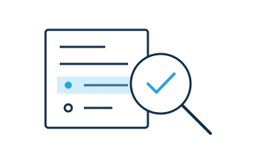

# Test and debug

Package tests can check widget content and interactions in a document. The authoring tool can also show the widget's HTML and package warnings. These checks help identify problems before publication.

Open the **Developer console** to examine package warnings, the selected element, and document HTML. Refresh the package when you change its built files. For automatic refresh, enable **Auto-reload**.

Do these checks for each widget.

- Save the document. Open it again. Make sure that the widget keeps the settings and authored content.
- Change an attribute from outside the widget. Check the display.
- Use undo and redo. Check the authored content.
- Test keyboard input, narrow layouts, preview, and printing.
- Wait for shared data before you write to it. Check that updates from other participants appear.

Export test modules as `./tests/<name>.js` or `./tests/<name>.*`. Run the modules from **Tests** in the **Developer console**. Each module runs in a separate frame with a time limit of 60 seconds.

To test a unit converter, change the saved target unit. Check that the widget calculates the new output. Use undo. Check that the widget restores the previous output. The [tutorial test module](../tutorial/07-testing-publishing.md) has a test without a test-runner dependency. For [Mocha](https://mochajs.org/getting-started/), `getMochaConfig()` from `@webwriter/build/test` supplies the reporting hooks.

The [test reporting reference](../reference/build-test.md#test-reporting) gives details for other test runners.

## Widget test cases

## Checks after saving and opening
