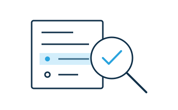

# Test and debug

Open the **Developer console** to inspect package warnings, the selected element, and document HTML. Refresh a package manually or enable **Auto-reload** while changing its built files.

For each widget, check:

- Settings and authored content survive saving and reopening.
- Attribute changes made elsewhere update the display.
- Undo and redo restore authored changes.
- Keyboard input, narrow layouts, preview, and printing work.
- Shared data initializes before writes and updates from another participant.

Expose test modules through `./tests/<name>.js` or `./tests/<name>.*`. Run them from the developer console's **Tests** tab. Each module runs in an isolated frame with a 60-second limit.

For a minimal test without a test-runner dependency, see the [tutorial's test module](../tutorial/07-testing-publishing.md). For Mocha, `@webwriter/build/test` exports `getMochaConfig()` with the reporting hooks already set up.

See the [test reporting reference](../reference/build-test.md#test-reporting) for other runners.
