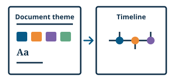

# Follow the theme

A widget can use the document's font, text color, and accent colors. A document stylesheet can use named parts to style specified elements inside the widget. Fallback values keep the text easy to read when a theme value is absent.



<!-- live-example: Themeable garden timeline -->

```js vanilla
class GardenTimeline extends HTMLElement {
  constructor() {
    super()
    this.attachShadow({mode: "open"}).innerHTML = `
      <style>
        :host { display: block; color: var(--ww-text-color, inherit); font-family: var(--ww-font-family, inherit); }
        section { display: grid; justify-items: start; gap: .6rem; padding: .75rem; border: 1px solid currentColor; border-radius: .5rem; }
        ol { display: grid; gap: .45rem; margin: 0; padding: 0; list-style: none; }
        li { display: flex; align-items: center; gap: .5rem; }
        .marker { inline-size: .8rem; block-size: .8rem; border: 1px solid currentColor; border-radius: 50%; background: var(--ww-theme-accent-1, currentColor); }
        li:nth-child(2) .marker { background: var(--ww-theme-accent-2, currentColor); }
        li:nth-child(3) .marker { background: var(--ww-theme-accent-3, currentColor); }
        li:last-child .marker { background: var(--ww-theme-accent-4, currentColor); }
      </style>
      <section>
        <strong>Community garden</strong>
        <ol>
          <li><span class="marker" part="opening-marker"></span>Plan the garden beds</li>
          <li><span class="marker"></span>Plant the seedlings</li>
          <li><span class="marker"></span>Open the garden</li>
        </ol>
        <button type="button">Change document theme</button>
      </section>`
    this.shadowRoot.querySelector("button").addEventListener("click", () => {
      const documentTheme = this.parentElement
      const forest = documentTheme.dataset.theme !== "forest"
      documentTheme.dataset.theme = forest ? "forest" : "ocean"
      const theme = forest
        ? ["#315d42", "#4f875e", "#8eb16a", "#c4a550", "Georgia, serif"]
        : ["#23486a", "#397da2", "#56a58e", "#d38a4d", "Arial, sans-serif"]
      for(const [index, value] of theme.slice(0, 4).entries()) {
        documentTheme.style.setProperty(`--ww-theme-accent-${index + 1}`, value)
      }
      documentTheme.style.setProperty("--ww-text-color", theme[0])
      documentTheme.style.setProperty("--ww-font-family", theme[4])
    })
  }
}

customElements.define("ww-garden-timeline", GardenTimeline)
```

```html
<section style="
  --ww-text-color: #23486a;
  --ww-font-family: Arial, sans-serif;
  --ww-theme-accent-1: #397da2;
  --ww-theme-accent-2: #56a58e;
  --ww-theme-accent-3: #d38a4d;
  --ww-theme-accent-4: #23486a
">
  <ww-garden-timeline></ww-garden-timeline>
</section>
```

<!-- /live-example -->

## Inherit the theme

Let text [inherit the font and color](https://developer.mozilla.org/en-US/docs/Web/CSS/Guides/Cascade/Inheritance) from the widget host. Use a [CSS custom property](https://developer.mozilla.org/en-US/docs/Web/CSS/Guides/Cascading_variables/Using_custom_properties) when a style needs a specific theme value. Give the property a fallback value. The first timeline marker uses the first accent color. If that color is absent, it uses the current text color.

```css
/* Inside the timeline's shadow stylesheet */
:host {
  display: block;
  color: var(--ww-text-color, inherit);
  font-family: var(--ww-font-family, inherit);
}

.marker {
  background: var(--ww-theme-accent-1, currentColor);
}
```

A document theme can set `--ww-font-family`, `--ww-font-size`, `--ww-text-color`, and `--ww-link-color`. It can also set `--ww-theme-accent-1` through `--ww-theme-accent-7`. Let the document set these properties. If text uses an accent color, check its contrast in each supported theme.

## Expose a named part

Give the first milestone marker a [part name](https://developer.mozilla.org/en-US/docs/Web/HTML/Reference/Global_attributes/part) in the shadow DOM. A document stylesheet can [use the part name](https://developer.mozilla.org/en-US/docs/Web/CSS/Reference/Selectors/::part) to add an outline.

```html
<span class="marker" part="opening-marker" aria-hidden="true"></span>
```

```css
/* In the document stylesheet */
ww-garden-timeline::part(opening-marker) {
  outline: 2px solid currentColor;
  outline-offset: 2px;
}
```

Select **Change document theme** in the preview to switch the font and colors. Remove the theme properties from the HTML pane to see the fallback styles.

[Design tokens reference](../reference/styling.md)

## Document theme properties and fallback values

## Theme checks for named parts
