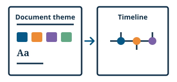

# Follow the theme

A widget can use the document's font, text color, and accent colors. A document stylesheet can use named parts to style specified elements inside the widget. Fallback values keep the text easy to read when a theme value is absent.



<!-- live-example: Themeable garden timeline -->

```js vanilla
class GardenTimeline extends HTMLElement {
  constructor() {
    super()
    this.attachShadow({mode: "open"}).innerHTML = `
      <style>
        :host { display: block; color: var(--ww-text-color, inherit); font-family: var(--ww-font-family, inherit); }
        section { display: grid; justify-items: start; gap: .6rem; padding: .75rem; border: 1px solid currentColor; border-radius: .5rem; }
        ol { display: grid; gap: .45rem; margin: 0; padding: 0; list-style: none; }
        li { display: flex; align-items: center; gap: .5rem; }
        .marker { inline-size: .8rem; block-size: .8rem; border: 1px solid currentColor; border-radius: 50%; background: var(--ww-theme-accent-1, currentColor); }
        li:nth-child(2) .marker { background: var(--ww-theme-accent-2, currentColor); }
        li:nth-child(3) .marker { background: var(--ww-theme-accent-3, currentColor); }
        li:last-child .marker { background: var(--ww-theme-accent-4, currentColor); }
      </style>
      <section>
        <strong>Community garden</strong>
        <ol>
          <li><span class="marker" part="opening-marker"></span>Plan the garden beds</li>
          <li><span class="marker"></span>Plant the seedlings</li>
          <li><span class="marker"></span>Open the garden</li>
        </ol>
        <button type="button">Change document theme</button>
      </section>`
    this.shadowRoot.querySelector("button").addEventListener("click", () => {
      const documentTheme = this.parentElement
      const forest = documentTheme.dataset.theme !== "forest"
      documentTheme.dataset.theme = forest ? "forest" : "ocean"
      const theme = forest
        ? ["#315d42", "#4f875e", "#8eb16a", "#c4a550", "Georgia, serif"]
        : ["#23486a", "#397da2", "#56a58e", "#d38a4d", "Arial, sans-serif"]
      for(const [index, value] of theme.slice(0, 4).entries()) {
        documentTheme.style.setProperty(`--ww-theme-accent-${index + 1}`, value)
      }
      documentTheme.style.setProperty("--ww-text-color", theme[0])
      documentTheme.style.setProperty("--ww-font-family", theme[4])
    })
  }
}

customElements.define("ww-garden-timeline", GardenTimeline)
```

```html
<section style="
  --ww-text-color: #23486a;
  --ww-font-family: Arial, sans-serif;
  --ww-theme-accent-1: #397da2;
  --ww-theme-accent-2: #56a58e;
  --ww-theme-accent-3: #d38a4d;
  --ww-theme-accent-4: #23486a
">
  <ww-garden-timeline></ww-garden-timeline>
</section>
```

<!-- /live-example -->

## Inherit the theme

Let text [inherit the font and color](https://developer.mozilla.org/en-US/docs/Web/CSS/Guides/Cascade/Inheritance) from the widget host. Use a [CSS custom property](https://developer.mozilla.org/en-US/docs/Web/CSS/Guides/Cascading_variables/Using_custom_properties) when a style needs a specific theme value. Give the property a fallback value. The first timeline marker uses the first accent color. If that color is absent, it uses the current text color.

```css
/* Inside the timeline's shadow stylesheet */
:host {
  display: block;
  color: var(--ww-text-color, inherit);
  font-family: var(--ww-font-family, inherit);
}

.marker {
  background: var(--ww-theme-accent-1, currentColor);
}
```

A document theme can set `--ww-font-family`, `--ww-font-size`, `--ww-text-color`, and `--ww-link-color`. It can also set `--ww-theme-accent-1` through `--ww-theme-accent-7`. Let the document set these properties. If text uses an accent color, check its contrast in each supported theme.

## Expose a named part

Give the first milestone marker a [part name](https://developer.mozilla.org/en-US/docs/Web/HTML/Reference/Global_attributes/part) in the shadow DOM. A document stylesheet can [use the part name](https://developer.mozilla.org/en-US/docs/Web/CSS/Reference/Selectors/::part) to add an outline.

```html
<span class="marker" part="opening-marker" aria-hidden="true"></span>
```

```css
/* In the document stylesheet */
ww-garden-timeline::part(opening-marker) {
  outline: 2px solid currentColor;
  outline-offset: 2px;
}
```

Select **Change document theme** in the preview to switch the font and colors. Remove the theme properties from the HTML pane to see the fallback styles.

[Design tokens reference](../reference/styling.md)

## Document theme properties and fallback values

The document theme sets these custom properties on the document root. A widget reads them with `var()` and always gives a fallback, because a document without a theme, an exported page, and a package preview do not set them.

| Property | Meaning | Fallback in the widget |
|---|---|---|
| `--ww-font-family`, `--ww-font-size` | The text font and size. | `inherit` |
| `--ww-text-color` | The text color. | `inherit` or `currentColor` |
| `--ww-link-color` | The link color. | `LinkText` |
| `--ww-theme-accent-1` to `--ww-theme-accent-7` | Seven accent colors, in this order. | `#44546a`, `#5b9bd5`, `#ed7d31`, `#f04b22`, `#ffc000`, `#8064a2`, `#70ad47` |
| `--ww-surface` | The color of a surface that a widget draws on: a card, a canvas, an input. | `Canvas` |
| `--ww-border-color` | Borders and dividers. It is the text color at 60 % strength, about 3:1 against the surface. | `color-mix(in srgb, currentColor 60%, transparent)` |
| `--ww-focus-color` | The focus ring. | `#0b5cad` |
| `--ww-success`, `--ww-danger`, `--ww-warning` | A correct, a wrong, and a cautionary state. Use them for text and borders on `--ww-surface`, and mix them with the surface for a tint. | `#1b7a3d`, `#b3261e`, `#8a5a00` |

```css
.card {
  background: var(--ww-surface, Canvas);
  border: 1px solid var(--ww-border-color, color-mix(in srgb, currentColor 60%, transparent));
  border-radius: .5rem;
}

.card:has(:focus-visible), button:focus-visible {
  outline: 2px solid var(--ww-focus-color, #0b5cad);
  outline-offset: 2px;
}

.answer[data-state="correct"] { border-color: var(--ww-success, #1b7a3d); }
.answer[data-state="wrong"] { border-color: var(--ww-danger, #b3261e); background: color-mix(in srgb, var(--ww-danger, #b3261e) 12%, var(--ww-surface, Canvas)); }
```

Use these tokens instead of a literal white background, a fixed gray border, a blue focus ring, or green and red for correct and wrong. A widget with literal colors cannot follow a theme with a dark page. Do not use color as the only sign of a state: add an icon or a word.

Every bundled theme (Base, Water, Simple, Sakura, Pico, Holiday) defines the six tokens, with the values in the table. The themes of the theme menu (Standard, Ocean, Forest, Sunset) are set on top of a bundled theme, so they have the tokens too. They set the accents, the text color, the link color, and the page background, and the border token follows the text color. The theme menu has no controls for the six tokens, but a theme saved from the menu keeps the values a document set. A document or an author overrides a token on the root or on an element:

```css
:root { --ww-surface: #fffdf7; --ww-danger: #a1221c; }
```

### Dark themes

The bundled themes are light (`color-scheme: only light`). A theme that has a dark page says so with the standard [`color-scheme`](https://developer.mozilla.org/en-US/docs/Web/CSS/Reference/Properties/color-scheme) property on the root, together with its colors:

```css
:root { color-scheme: dark; background-color: #14181c; color: #e6e9ec; }
```

The tokens are written with [`light-dark()`](https://developer.mozilla.org/en-US/docs/Web/CSS/Reference/Values/color_value/light-dark) and the system color `Canvas`, so they take their dark values under `color-scheme: dark`. A theme with `color-scheme: light dark` follows the reader's `prefers-color-scheme`. A widget does not need to know which one applies. It uses the tokens, and `light-dark()` for colors of its own: `color: light-dark(#243746, #d8e3ec)`. Do not use `prefers-color-scheme` to choose colors in a widget: the theme of the document, not the system setting, decides.

### Read a token in script

A canvas or a chart library needs a resolved color, not the text `var(--ww-surface, Canvas)`. Let the browser resolve it on an element of the widget:

```js
const probe = this.shadowRoot.querySelector("[data-probe]")
const color = token => {
  probe.style.color = token
  return getComputedStyle(probe).color // "rgb(255, 255, 255)"
}
const surface = color("var(--ww-surface, Canvas)")
const danger = color("var(--ww-danger, #b3261e)")
```

Read the colors again when the theme changes. The editor sends the `ww-themechange` event on the document after the theme changes: another bundled theme, a stylesheet in the head, or theme properties on the root or the body. A theme with `color-scheme: light dark` also changes when the reader's `prefers-color-scheme` changes.

```js
connectedCallback() {
  this.ownerDocument.addEventListener("ww-themechange", this.#theme)
  this.#dark = matchMedia("(prefers-color-scheme: dark)")
  this.#dark.addEventListener("change", this.#theme)
}

disconnectedCallback() {
  this.ownerDocument.removeEventListener("ww-themechange", this.#theme)
  this.#dark?.removeEventListener("change", this.#theme)
}

#theme = () => this.#draw()
```

The event bubbles, carries `detail.theme` (the name of the bundled theme, such as `"base"`), and is not cancelable. It is sent once for a batch of changes, after they were applied. An exported page has no editor and sends no event; a widget there draws with the theme that the page has. The [Scene](../reference/lit.md#scene) module listens to the event itself and reads its styles again, so a scene needs no code for it.

## Theme checks for named parts

A named part is part of the widget's interface. Check it like one.

1. **The part works from a document stylesheet.** Style it from the document and read the result. The check fails if the element has no `part` attribute, if the name is misspelled, or if the element is inside another shadow root that does not export the part with [`exportparts`](https://developer.mozilla.org/en-US/docs/Web/HTML/Reference/Global_attributes/exportparts).

   ```js
   const sheet = new CSSStyleSheet()
   sheet.replaceSync("ww-garden-timeline::part(opening-marker) { outline: 3px solid rgb(255, 0, 0) }")
   document.adoptedStyleSheets.push(sheet)
   const marker = widget.shadowRoot.querySelector("[part~=opening-marker]")
   assert.equal(getComputedStyle(marker).outlineColor, "rgb(255, 0, 0)")
   ```

2. **The part looks right without a document rule.** A rule of the document that styles `::part(name)` replaces the widget's own style of that property. Give the part only its default look and keep the layout in elements that are not parts. Do not use `!important` in the widget on a part: it would stop the document from styling it.
3. **Only the part itself can be styled.** `::part(name):hover` and `::part(name)::before` work, but `::part(name) span` does not. Make each element that a document should style a part of its own, and write down the name and what it styles.
4. **The tokens apply.** Set a token on the document and check that the widget changes: `document.documentElement.style.setProperty("--ww-surface", "rgb(10, 10, 10)")`, then read the computed `background-color` of the widget's surface.
5. **The widget reads well in each theme.** Open it in each bundled theme, in the saved themes, in a theme with `color-scheme: dark` and a dark page, and in a document without a theme. Check that the text has a contrast ratio of at least 4.5:1, that borders and the focus ring have at least 3:1 against what is behind them, and that nothing stays white on a dark page.
6. **The focus ring shows in every theme.** Press Tab through the widget in each of them.
