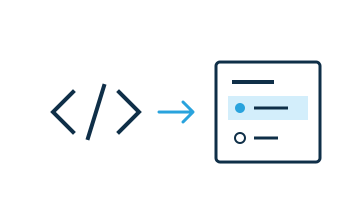

# Widgets

Widgets are interactive multimedia elements that can be part of a web document. They are implemented as Web Components and distributed as npm packages.



This documentation is intended for developers. Start with the widget basics and quick start, then follow the tutorial, solve a specific task with a guide, or look up an interface in the reference.

Choose **JS**, **Lit**, **React**, **Vue**, **Angular**, or **Svelte** with the library selector. The widget interface, authored HTML, and CSS are independent of the rendering library. The quick start and tutorial include complete sources and live examples for all six choices.

| Page or section | Contents |
|---|---|
| [Quick start](introduction/quick-start.md) | Create, insert, and modify a small widget. |
| [Tutorial](tutorial/index.md) | Build a quiz widget step by step, with code and working examples. |
| [Guides](guides/index.md) | State, sharing, layout, accessibility, localization, testing, and publishing. |
| [Reference](reference/index.md) | Editing configuration, runtime interfaces, options, events, styles, and distribution. |

## What is a widget?

From a technical view, a widget is an HTML custom element. Its class extends `HTMLElement`, directly or through a library such as Lit. It can use the web APIs available in the browser.

```html
<ww-quiz answer="false">
  <p>The Moon is a star.</p>
</ww-quiz>
```

The tag name identifies the widget. Attributes hold settings, child nodes hold authored content, and the shadow DOM contains the widget's interface.

A package can provide one or more widgets, plus snippets, styles, and tests. Packaging makes widgets discoverable and loadable in WebWriter.

### Widgets and the document

The live HTML DOM is the document. WebWriter observes changes to it, including changes made by widgets, collaborators, and undo or redo.

| Store | Use | Saved with the document? |
|---|---|---|
| Attributes | Settings such as the correct answer. | Yes. |
| Light-DOM children | Authored text and nested content. | Yes. |
| Scoped data block | Persistent interaction state, such as a learner's answer. | Stored separately; normal exports keep authored defaults. |
| Properties and shadow DOM | Temporary state and the widget's interface. | No. |

Render controls in the widget's shadow DOM. Use a `<slot>` to display authored children without moving or replacing them. Editor-owned menus and overlays belong in the editor's shadow appendix.

Changes can come from elsewhere at any time. Read the current attributes and children when an interaction occurs, and update the display when those values change. Clean up observers and external listeners when the widget disconnects.

WebWriter marks installed widgets with `contenteditable` while editing. Use `this.isContentEditable` to distinguish editing from use. Temporary `◆` classes and editor-owned `contenteditable` are excluded from collaboration, history, and saved HTML.

Next: [Quick start](introduction/quick-start.md).
