# Widgets

Widgets are interactive multimedia elements that can be part of a web document. They are implemented as Web Components and distributed as npm packages.

This documentation is intended for developers. Start with the widget basics and quick start, then follow the tutorial, solve a specific task with a guide, or look up an interface in the reference.

Choose **JS**, **Lit**, **React**, **Vue**, **Angular**, or **Svelte** with the library selector. The widget interface, authored HTML, and CSS are independent of the rendering library. The quick start and tutorial include complete sources and live examples for all six choices.

| Page or section | Contents |
|---|---|
| [Quick start](introduction/quick-start.md) | Create, insert, and modify a small widget. |
| [Tutorial](tutorial/index.md) | Build Ghost Disco step by step, with code and working examples. |
| [Guides](guides/index.md) | State, sharing, layout, accessibility, localization, testing, and publishing. |
| [Reference](reference/index.md) | Editing configuration, runtime interfaces, options, events, styles, and distribution. |

## What is a widget?

From a technical view, a widget is an HTML custom element. Its class extends `HTMLElement`, directly or through a library such as Lit. It can use the web APIs available in the browser.

```html
<ww-weather place="Utrecht">
  <p>Schoolyard forecast</p>
</ww-weather>
```

The tag name identifies the widget. Attributes hold settings, child nodes hold authored content, and the shadow DOM contains the widget's interface.

A package can provide one or more widgets, plus snippets, styles, and tests. Packaging makes widgets discoverable and loadable in WebWriter.

The live HTML DOM is the document. WebWriter observes changes to it, including changes made by widgets, collaborators, and undo or redo.

### What widgets can do

<nav class="widget-capabilities" aria-labelledby="what-widgets-can-do">
  <div class="widget-capabilities-map">
    <div class="widget-capabilities-core">
      <div class="widget-capabilities-document">
        <strong class="widget-capabilities-document-title">HTML document</strong>
        <div class="widget-capabilities-lines" aria-hidden="true"></div>
        <div class="widget-capabilities-example">
          <div class="widget-capabilities-example-title"><strong>Widget</strong><code>&lt;ww-weather&gt;</code></div>
          <div class="widget-capabilities-example-output" aria-hidden="true">
            <strong>Schoolyard forecast</strong>
            <span>Utrecht · 12 °C · Cloudy</span>
          </div>
        </div>
        <div class="widget-capabilities-lines" aria-hidden="true"></div>
      </div>
    </div>
    <div class="widget-capabilities-rail widget-capabilities-left">
      <h4>Authoring</h4>
      <ul>
        <li>
          <a href="guides/editing.md" aria-describedby="widget-guide-editing">
            <svg aria-hidden="true" width="32" height="32"><use href="../images/widgets/capability-icons.svg#editing"></use></svg>
            <template>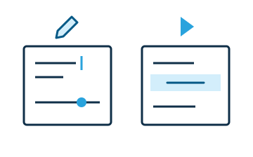</template>
            <span>Support editing</span>
          </a>
          <p id="widget-guide-editing" class="widget-capabilities-summary">Show configuration to authors and interaction controls to readers.</p>
        </li>
        <li>
          <a href="guides/focus.md" aria-describedby="widget-guide-focus">
            <svg aria-hidden="true" width="32" height="32"><use href="../images/widgets/capability-icons.svg#focus"></use></svg>
            <template>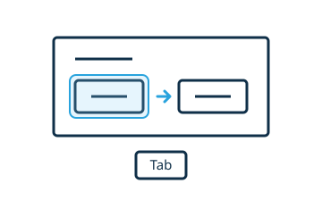</template>
            <span>Handle selection &amp; input</span>
          </a>
          <p id="widget-guide-focus" class="widget-capabilities-summary">Delegate focus to controls, handle keyboard input, and move document selection.</p>
        </li>
        <li>
          <a href="guides/content.md" aria-describedby="widget-guide-content">
            <svg aria-hidden="true" width="32" height="32"><use href="../images/widgets/capability-icons.svg#content"></use></svg>
            <template>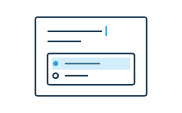</template>
            <span>Nest content</span>
          </a>
          <p id="widget-guide-content" class="widget-capabilities-summary">Use slots to display editable text and nested widgets from the light DOM.</p>
        </li>
        <li>
          <a href="guides/conversions.md" aria-describedby="widget-guide-conversions">
            <svg aria-hidden="true" width="32" height="32"><use href="../images/widgets/capability-icons.svg#conversions"></use></svg>
            <template>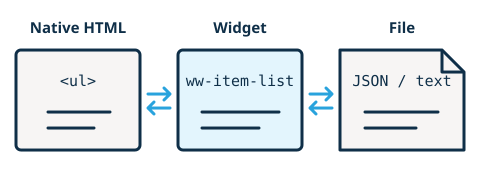</template>
            <span>Convert &amp; import/export</span>
          </a>
          <p id="widget-guide-conversions" class="widget-capabilities-summary">Convert between widgets, native HTML, and file formats.</p>
        </li>
      </ul>
      <h4>Presentation</h4>
      <ul>
        <li>
          <a href="guides/responsiveness.md" aria-describedby="widget-guide-responsiveness">
            <svg aria-hidden="true" width="32" height="32"><use href="../images/widgets/capability-icons.svg#responsiveness"></use></svg>
            <template>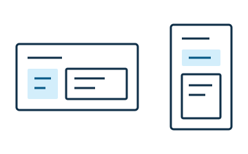</template>
            <span>Responsive layout</span>
          </a>
          <p id="widget-guide-responsiveness" class="widget-capabilities-summary">Reflow controls and content to fit the space the document gives the widget.</p>
        </li>
        <li>
          <a href="guides/localization.md" aria-describedby="widget-guide-localization">
            <svg aria-hidden="true" width="32" height="32"><use href="../images/widgets/capability-icons.svg#localization"></use></svg>
            <template>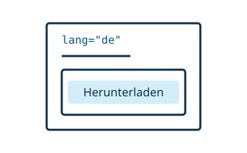</template>
            <span>Localization</span>
          </a>
          <p id="widget-guide-localization" class="widget-capabilities-summary">Use the document’s language for widget text and labels.</p>
        </li>
        <li>
          <a href="guides/printing.md" aria-describedby="widget-guide-printing">
            <svg aria-hidden="true" width="32" height="32"><use href="../images/widgets/capability-icons.svg#printing"></use></svg>
            <template>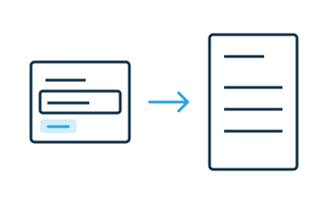</template>
            <span>Printing</span>
          </a>
          <p id="widget-guide-printing" class="widget-capabilities-summary">Use print styles to turn interactive controls into a useful paper version.</p>
        </li>
      </ul>
    </div>
    <div class="widget-capabilities-rail widget-capabilities-right">
      <h4>State and participation</h4>
      <ul>
        <li>
          <a href="guides/state.md" aria-describedby="widget-guide-state">
            <svg aria-hidden="true" width="32" height="32"><use href="../images/widgets/capability-icons.svg#state"></use></svg>
            <template>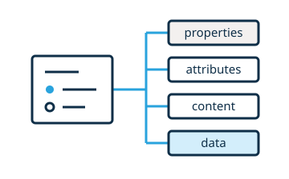</template>
            <span>State, options and actions</span>
          </a>
          <p id="widget-guide-state" class="widget-capabilities-summary">Choose where state lives and expose saved settings in the Widget drawer.</p>
        </li>
        <li>
          <a href="guides/reactivity.md" aria-describedby="widget-guide-reactivity">
            <svg aria-hidden="true" width="32" height="32"><use href="../images/widgets/capability-icons.svg#reactivity"></use></svg>
            <template>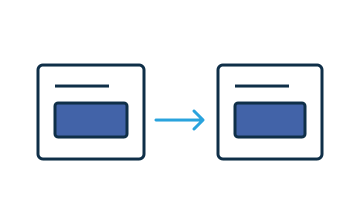</template>
            <span>Make data reactive</span>
          </a>
          <p id="widget-guide-reactivity" class="widget-capabilities-summary">Connect widgets with signals so a source value updates another widget.</p>
        </li>
        <li>
          <a href="guides/sharing.md" aria-describedby="widget-guide-sharing">
            <svg aria-hidden="true" width="32" height="32"><use href="../images/widgets/capability-icons.svg#sharing"></use></svg>
            <template>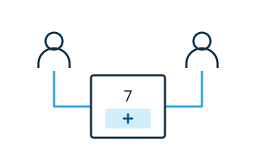</template>
            <span>Shared responses</span>
          </a>
          <p id="widget-guide-sharing" class="widget-capabilities-summary">Keep participant data individual or share it with everyone or a group.</p>
        </li>
        <li>
          <a href="guides/live-sessions.md" aria-describedby="widget-guide-live-sessions">
            <svg aria-hidden="true" width="32" height="32"><use href="../images/widgets/capability-icons.svg#live-sessions"></use></svg>
            <template>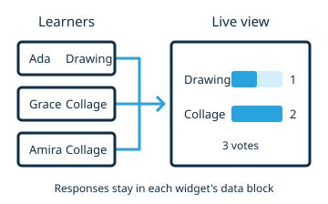</template>
            <span>Live sessions and participant controls</span>
          </a>
          <p id="widget-guide-live-sessions" class="widget-capabilities-summary">Configure learner interactions and show individual or aggregated responses to the host.</p>
        </li>
      </ul>
      <h4>Build and distribution</h4>
      <ul>
        <li>
          <a href="guides/libraries.md" aria-describedby="widget-guide-libraries">
            <svg aria-hidden="true" width="32" height="32"><use href="../images/widgets/capability-icons.svg#libraries"></use></svg>
            <template>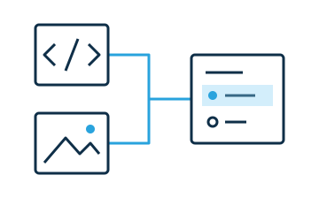</template>
            <span>Libraries and assets</span>
          </a>
          <p id="widget-guide-libraries" class="widget-capabilities-summary">Load dependencies, styles, and media alongside your custom element.</p>
        </li>
        <li>
          <a href="guides/testing.md" aria-describedby="widget-guide-testing">
            <svg aria-hidden="true" width="32" height="32"><use href="../images/widgets/capability-icons.svg#testing"></use></svg>
            <template>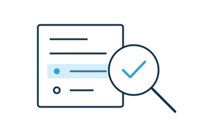</template>
            <span>Test, debug and optimize</span>
          </a>
          <p id="widget-guide-testing" class="widget-capabilities-summary">Check widget behavior and include only the optional code a saved document needs offline.</p>
        </li>
        <li>
          <a href="guides/migrations.md" aria-describedby="widget-guide-migrations">
            <svg aria-hidden="true" width="32" height="32"><use href="../images/widgets/capability-icons.svg#migrations"></use></svg>
            <template>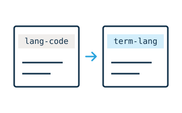</template>
            <span>Content migration</span>
          </a>
          <p id="widget-guide-migrations" class="widget-capabilities-summary">Update older widget HTML while preserving authored content.</p>
        </li>
        <li>
          <a href="guides/publishing.md" aria-describedby="widget-guide-publishing">
            <svg aria-hidden="true" width="32" height="32"><use href="../images/widgets/capability-icons.svg#publishing"></use></svg>
            <template>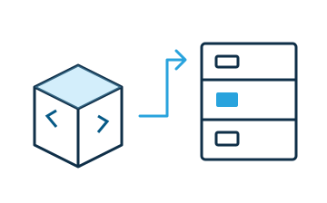</template>
            <span>Publishing</span>
          </a>
          <p id="widget-guide-publishing" class="widget-capabilities-summary">Publish a widget package or embed it on another site with result storage.</p>
        </li>
      </ul>
    </div>
  </div>
  <div class="widget-capabilities-preview" popover="manual" hidden aria-hidden="true">
    
    <p></p>
  </div>
</nav>

Next: [Quick start](introduction/quick-start.md).
